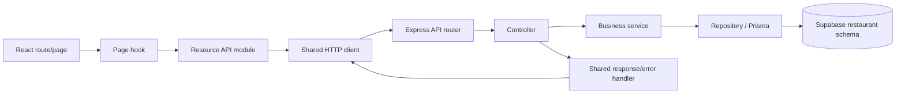

# 三太子亭 — Santaishi-tei

A Japanese restaurant website and staff workspace. This repository contains the CSR application developed in Blocks 6–7 and extended with Block 9 JWT authentication/authorization and Block 10 administrator TOTP MFA. React renders the interface in the browser, while an Express REST API uses Prisma to access Supabase PostgreSQL.

Visitors explore the restaurant, browse dishes and view public ingredient information. Chefs maintain their assigned dishes and recipes and record ingredient usage or waste. Administrators additionally manage ingredients, categories, stock receipts, corrections and chef accounts. Customer accounts, ordering and reservations are outside the project's scope.

Block 9 adds email activation, administrator approval, password recovery and email OTP at staff login. **Block 10** adds optional administrator TOTP, a 30-second lockout on the fourth failure, replay protection and hashed, single-use recovery codes. Authentication uses 15-minute JWTs in sessionStorage with no application cookies. See [Blocks 9–10 authentication and permissions](docs/block9-authentication.md) for flows, expiry, API contracts and limitations.

## Submission contents

This Block 10 package includes application source, public assets, Prisma schema/migrations, tests and documentation. Dependencies, private environment files, generated builds and historical presentations are excluded. `.env.example` contains public placeholders only. Begin with the disposable demo below to review the website without shared credentials; real Supabase access requires private configuration.

## Requirements and run modes

There are two ways to run the website:

| Mode | Best for | Database and accounts |
|---|---|---|
| Disposable demo | Trying the interface, animations and pagination without credentials | Temporary local database with demo accounts; changes disappear on shutdown |
| Development with Supabase | Working with the restaurant's persistent data | Requires private configuration and an existing staff account |

Both modes require **Node.js 24 or later**, npm and the complete repository, including `public/` and `package-lock.json`. Use a current browser with JavaScript enabled.

Run every command below from the **extracted Block 10 submission directory**, where this application's `package.json` is located—not the parent repository or `restaurant-mvc`.

```sh
cd "10_24127278_24127322_24127497_Block 10"
node --version
npm --version
```

If the terminal is already in the extracted folder containing `package.json`, skip the `cd` command.

## Quick start: disposable demo

Use this mode to review the interface, animations and restaurant workflows without Supabase credentials.

```sh
npm ci
npm run db:generate
npm run build
npm run preview:fixture -- --large
```

Open **http://127.0.0.1:3003**. Keep the terminal running; press **Ctrl+C** to stop the server.

The `--large` option adds 1,200 temporary demo dishes for pagination and search. This preview does not load `.env`, connect to Supabase or modify shared records.

| Preview account | Email | Password |
|---|---|---|
| Administrator | `admin@example.test` | `Fixture-only-passphrase-2026` |
| Chef | `chef@example.test` | `Fixture-only-passphrase-2026` |

For this isolated preview only, sign-in and authenticator-setup email codes are printed in the terminal instead of sent by email. Google Authenticator enrollment and TOTP verification work in the preview, but restart discards its accounts and authenticator configuration. Enter that code after the password step. The real application never logs codes.

The preview injects mock delivery and Storage. It does not demonstrate real SMTP delivery or Google CAPTCHA verification. Use the configured Supabase mode to test those integrations.

These accounts exist **only in the disposable preview**. They cannot sign in to the Supabase-backed application.

The preview serves a built version of the frontend. After editing frontend files, run `npm run build` again and refresh the browser. For automatically refreshed frontend development, use the Supabase setup below.

## Development with Supabase

### Install dependencies and generate Prisma Client

After cloning the repository:

```sh
npm ci
npm run db:generate
```

- **`npm ci`** installs the exact versions in `package-lock.json`. Run it on first setup and when dependency versions change. It replaces the local `node_modules` directory; it does not change restaurant records.
- **`npm run db:generate`** generates Prisma Client from `prisma/schema.prisma`. Run it after installation and after pulling schema changes. It does not create tables or apply migrations, and does not require database credentials.
- **Migration commands** change the database structure. They are a separate setup step, not something each teammate should run whenever the website starts.

Use the project's npm commands rather than an arbitrary `npx prisma` command. In particular, Prisma's configuration does not automatically load `.env` for direct CLI calls.

### Configure the private environment

Create a file named `.env` beside `package.json` using a text editor. If it already exists, edit it without replacing its contents. Environment files are ignored by Git, so cloning the repository does not provide credentials.

Use these settings, replacing placeholder values privately:

```dotenv
NODE_ENV=development
PORT=3001
APP_ORIGIN=http://127.0.0.1:3000
DATABASE_URL="YOUR_SUPABASE_POSTGRESQL_CONNECTION_URI"
JWT_SECRET="YOUR_RANDOM_SECRET_AT_LEAST_32_CHARACTERS"
MFA_ENCRYPTION_KEY="YOUR_SEPARATE_RANDOM_64_HEX_CHARACTER_KEY"
SMTP_HOST=smtp.gmail.com
SMTP_PORT=587
SMTP_SECURE=false
SMTP_USER="YOUR_SENDER_EMAIL"
SMTP_PASSWORD="YOUR_SMTP_APP_PASSWORD"
SMTP_FROM="YOUR_SENDER_EMAIL"
RECAPTCHA_SITE_KEY="YOUR_V2_SITE_KEY"
RECAPTCHA_SECRET_KEY="YOUR_V2_SECRET_KEY"

# Needed for photo uploads:
SUPABASE_URL="YOUR_SUPABASE_PROJECT_URL"
SUPABASE_SECRET_KEY="YOUR_SERVER_ONLY_SUPABASE_SECRET_KEY"
SUPABASE_STORAGE_BUCKET=dish-photos

# Needed only when deploying database migrations:
MIGRATION_DATABASE_URL="YOUR_MIGRATION_CONNECTION_URI_WITH_SCHEMA_RESTAURANT"
```

`DATABASE_URL` is a PostgreSQL connection URI, not the Supabase project URL or an API key. Use the project's Session pooler connection details for the existing setup. Obtain credentials from the project owner privately. URL-encode special characters in a database password when placing it in a URI.

Generate a JWT signing secret locally with:

```sh
node -e "console.log(require('node:crypto').randomBytes(32).toString('hex'))"
```

Generate a separate authenticator encryption key with `openssl rand -hex 32` and set `MFA_ENCRYPTION_KEY`. Keep this key backed up and stable: changing it makes existing authenticator secrets unreadable. Never reuse `JWT_SECRET` for it.

Store the results in `.env`, not in source code. Do not share screenshots containing secrets. Never prefix server secrets with `VITE_`; Vite is configured not to read this project's environment files.

Storage settings are required for photo uploads, not for displaying existing local images. The legacy `SUPABASE_SERVICE_ROLE_KEY` is supported instead of `SUPABASE_SECRET_KEY`. `SUPABASE_STORAGE_BUCKET` is a bucket **name**, not another key; it defaults to `dish-photos`. See [photo upload configuration](docs/photo-uploads.md).

### Email and CAPTCHA setup

Staff must have a real inbox they can access for activation, password recovery and authenticator enrollment. Chefs and administrators without TOTP receive an email code at each login; administrators with TOTP use their authenticator instead. The SMTP sender and the staff recipient may use the same inbox. With Gmail SMTP, use an app password for `SMTP_PASSWORD`, not the ordinary account password.

Use **reCAPTCHA v2 checkbox** keys for registration. Add the development hostnames used by the browser (`localhost` and/or `127.0.0.1`) to the key's allowed domains; configure the deployed hostname separately. Do not use v3 keys. The site key is public; the secret key remains server-only.

`APP_ORIGIN` determines the address in verification/reset emails. Development permits `localhost` and `127.0.0.1` interchangeably on the configured scheme and port; production permits only the configured origin. Changing `.env` requires an API restart.

### Prepare the database only when necessary

**Using the team's existing exercise database:** do not recreate or seed it. The Block 9 authentication/ownership and Block 10 MFA migrations are already applied to the submission's shared exercise database. Other copies may need the migrations below. Existing passwords and restaurant records are preserved.

**Adding Block 9 to an existing Block 6/7 restaurant database:** the database owner applies the authentication/ownership migration with:

```sh
npm run db:migrate:auth
```

This wrapper privately loads server configuration, applies the Block 9 migration transactionally, records its Prisma migration history and verifies existing fields and records are unchanged. It expects the earlier restaurant schema and its Prisma migration history in `restaurant`. It applies only the Block 9 migration, not every older pending migration. A matching applied migration can be rerun safely. It is not the initialization command for an empty database.

**Adding Block 10 to an existing Block 9 database:** the database owner applies:

```sh
npm run db:migrate:mfa
```

This additive migration creates `admin_mfa`, `mfa_challenges` and `mfa_recovery_codes`, verifies that existing data is unchanged, and records its migration checksum. It is safe to rerun an already applied matching migration. It does not enable TOTP for existing admins automatically. For a Block 6/7 database, apply the authentication migration first, then this MFA migration. Restart the API after migration or configuration changes.

**Using a new, empty database:** configure `MIGRATION_DATABASE_URL` with the connection intended for migrations and the query parameter `schema=restaurant`. Use `?schema=restaurant` if the URI has no query string, or `&schema=restaurant` if it already has one. Then run:

```sh
node --env-file=.env scripts/prisma.js migrate deploy
npm run admin:create
```

The first command explicitly loads local configuration and applies the checked-in migration history. The second prompts for the first administrator's name, email and a password of at least 12 characters. It will not replace an existing administrator. Use a real reachable email for this administrator. Chefs may register through the website for approval, or an administrator may provision them through the office; provisioned chefs still need email verification.

An empty database does not contain the team's menu or inventory. Add categories and dishes through the application, or review the optional [inventory demo import](docs/demo-data.md) and [pagination demo import](docs/block7-demo-dishes.md), including their prerequisites. Imports write records; they are not required to start the server.

Do not use `prisma migrate reset` or `prisma db push` on the shared exercise database. If tables exist without the expected migration history, resolve that history with the database owner before applying migrations.

### Start the application

```sh
npm run dev
```

Open **http://127.0.0.1:3000**. This starts both processes:

| Process | Port | Purpose |
|---|---|---|
| Vite | `3000` | Serves React and frontend assets |
| Express | `3001` | Serves `/api` and connects to Supabase |

Vite forwards `/api` requests to `127.0.0.1:3001`. Keep `PORT=3001` for this development configuration. Development accepts both `localhost` and `127.0.0.1` on the configured port; they still have separate browser sessionStorage. Use one consistently and set `APP_ORIGIN` to the preferred address for email links. Production accepts only the configured origin. Restart the API after configuration changes.

Wait for both Vite's startup URL and the API's listening message. A Vite URL alone does not mean the database connection succeeded. Keep the terminal open and use **Ctrl+C** to stop both processes. Restart after changing `.env`.

For later runs, normally only `npm run dev` is needed. After pulling updates, rerun `npm ci` if dependencies changed and `npm run db:generate` if the Prisma schema changed.

## Account workflows

### Register and sign in

1. Open **Staff entrance → Chef registration**. Enter a display name, email, password of at least 12 characters and matching confirmation, then complete reCAPTCHA v2.
2. Open the activation email and confirm verification. The link is single-use and expires after **24 hours**. Use the resend link on the registration confirmation screen or the unverified-login message if needed.
3. An administrator opens the chef's profile in the office and approves the application. Email verification alone does not grant access.
4. Sign in with email and password. Enter the six-digit email OTP within **5 minutes**. Five incorrect codes exhaust that challenge. Return to sign-in to request another after the one-minute cooldown.
5. After OTP verification, the browser receives an access JWT valid for **15 minutes**. There is no refresh token or remember-me cookie; sign in again after expiry.

Forgot-password links are single-use and expire after **30 minutes**. A reset invalidates pending login challenges. Chefs keep email OTP. Administrators can enable TOTP and recovery codes using the Block 10 flow below.

An administrator account inherited from demo data may contain a fictional email. A database owner can replace that email in `restaurant.staff_users` with a unique real address while preserving its ID, password and role. An address already used by another staff account cannot be assigned to the administrator.

### Block 10: set up Google Authenticator

Prerequisites: an active, approved, email-verified administrator account; access to its inbox; the Block 10 migration; and a configured `MFA_ENCRYPTION_KEY`. Existing admins keep email sign-in until they complete enrollment. The authenticator is enabled per admin account, not globally.

1. Start the website with `npm run dev` and open `http://127.0.0.1:3000` (or the configured browser origin). Sign in as admin using the password and email code.
2. Install **Google Authenticator** on a phone. It can be used without a Google account. Enable automatic date/time on the phone and keep the server clock synchronized. See [Google Authenticator help](https://support.google.com/accounts/answer/1066447?hl=en).
3. Open **Office → Account security → Set up authenticator**.
4. Confirm the current password, then enter the six-digit setup code delivered by email. The email challenge expires after five minutes. In the disposable preview, find this fictional setup code in the terminal instead.
5. In Google Authenticator, select **+ / Add a code → Scan a QR code** and scan the restaurant's QR code. If scanning is unavailable, expand **Can’t scan? Enter this key manually** on the website, choose **Enter a setup key** in Authenticator, enter the displayed key, and select **Time based**. A label such as “Santaishi-tei admin” identifies the entry.
6. Submit the six-digit code shown by that authenticator entry. The QR/manual-key confirmation step expires after ten minutes.
7. Save the ten recovery codes using **Download recovery codes**, or copy them into secure storage separate from the phone. Select **I saved my recovery codes securely**, then **Finish & continue** within ten minutes. Codes are shown only once. TOTP becomes active only after this acknowledgement.
8. Sign out and sign in again. The admin now receives an authenticator challenge instead of a login email. If the setup code is still displayed, wait for the next code: a successfully used time step cannot be reused.

The QR code/manual key is the authenticator secret. Keep it and the recovery-code file private; do not include them in screenshots, source control or the submission ZIP. No Google API key is needed for Google Authenticator. The restaurant generates the QR code locally with `qrcode` and verifies TOTP using `otplib`.

### Block 10: manual testing checklist

Run tests with the same admin account that completed enrollment. A successful factor verification resets prior MFA failures; complete a successful login before starting the four-failure test so earlier replay tests do not affect the count.

| Test | Actions | Expected result |
|---|---|---|
| Normal TOTP login | Sign out, submit the correct admin email/password, then a fresh authenticator code. | Login succeeds without sending an email sign-in code. |
| Reject a reused code | After a successful login, sign out and attempt the same code again. Then wait for a new code and submit it. | The used code fails; the fresh code succeeds. |
| Fourth-failure lockout | After a successful login, sign out, pass the password step and submit an incorrect six-digit code four times. Use a value different from the displayed code. | Failures 1–3 show an invalid-code error; failure 4 shows `MFA_LOCKED` and a 30-second countdown. |
| Lockout expiry | Wait until the countdown finishes, then submit a fresh correct code. | Login succeeds. The challenge must still be within its five-minute lifetime; otherwise restart sign-in. |
| Account-wide lockout | In a separate run of the lockout test, return to password login while locked and attempt to start another login. | The account remains locked. Starting another challenge or using recovery does not bypass it. Requests during lockout do not extend the server deadline. |
| Recovery login | Sign out, pass the password step, select **Use a recovery code instead**, and submit one complete saved code. | Login succeeds; Account security shows nine unused codes if the set was previously untouched. |
| Recovery replay | Sign out and try that same recovery code again. | It is rejected. Another unused recovery code or a fresh authenticator code still works. |
| Replace recovery codes | Open Account security → **Replace recovery codes**. Confirm the password and a fresh authenticator or unused recovery code; save and acknowledge the new set. | Ten new codes become active; every code from the previous set stops working. |
| Turn TOTP off | Open Account security → **Turn off authenticator**. Confirm the password and a fresh authenticator or unused recovery code. Sign out and log in again. | Login returns to email OTP. Previous authenticator/recovery codes no longer authorize login. |
| Chef regression | Sign in as a chef. | Chef login still uses email OTP; the admin Security page is forbidden. |

**Last-code recovery:** optionally test in the disposable preview by signing in with each unused recovery code. When the final code is consumed, the app displays a replacement set and requires saving/acknowledging it before issuing the JWT. Complete this step within ten minutes. Do not discard the authenticator entry while testing: if the final-code response is lost or expires, the authenticator is needed to recover.

**Separate limits:** the fourth-failure TOTP lockout lasts 30 seconds. The existing per-IP limit allows 20 authentication mutations in 15 minutes, and password login has a separate per-email limit of ten attempts in 15 minutes. A “try again after 15 minutes” message is the broader `RATE_LIMITED` limit, not the TOTP countdown. Space out longer demonstrations, especially the ten-code exhaustion test. The automated suite tests exhaustion without waiting on the HTTP IP limiter.

**Troubleshooting:** use the correct Santaishi-tei entry, enable automatic phone time, wait for a fresh code after any successful verification, and check that the server clock is correct. Setup errors mentioning authenticator configuration require a 64-hex-character `MFA_ENCRYPTION_KEY` and an API restart. Keep the original encryption key stable; generating a different one cannot decrypt existing enrollment secrets.

### Block 10: security behavior and automated checks

Authenticator secrets are encrypted with AES-256-GCM using the separate encryption key. Recovery codes are stored as Argon2id hashes. Database row locks make code consumption and accepted time-step updates atomic, preventing concurrent reuse. The persistent per-account failure counter survives browser refreshes and application restarts.

Only admins may manage MFA, and settings apply to the verified JWT subject's own active, approved, verified account. Settings changes require fresh proof. JWT verification itself remains database-free and cookie-free; checking MFA state and dish ownership are separate resource operations. Existing JWTs may remain valid for their remaining lifetime, up to 15 minutes, after MFA changes. The SSR sibling does not implement the CSR TOTP feature.

Run `npm test` for the complete isolated suite, or after installing and generating Prisma Client, run `node --test tests/mfa.test.js` for focused MFA checks. Tests use a disposable database and mocked email, never the real `.env` or Supabase. The last Block 10 verification run passed **66 tests**, including enrollment, encrypted/hashed storage, lockout timing, concurrent replay protection, recovery replacement, permissions and restaurant regressions.

### Manage chef accounts

Select a chef card in the office to open the profile modal. It contains profile details, the staff-access checkbox, approval/rejection controls and a separate permanent-deletion section. Cards remain compact while a profile is open.

- **Disable access:** clear **Allow staff access**, then save. The account, email and restaurant history remain.
- **Approve/reject:** changes application status. Sign-in requires an active account, verified email and approved application.
- **Permanently delete:** choose **Delete chef account…**, type that chef's email and confirm. Successful deletion frees the address for testing or registration again, removes authentication challenges and unassigns dishes without deleting them.
- **History protection:** deletion is blocked if the account is referenced as a recipe editor or stock-journal actor. Disable access instead. This endpoint cannot delete administrator accounts.

Permanent deletion is irreversible. Already-issued JWTs can remain usable until their 15-minute expiry, including after account deletion or disabling access.

### Assign and publish dishes

A chef's new dish is a draft assigned to that chef. Administrators assign or change the responsible chef in the dish editor. Existing dishes migrated into Block 9 remain unassigned until an administrator assigns them. Each chef can own multiple dishes.

Chefs can edit their own non-archived dishes and recipes, including published dishes. Only administrators can publish, unpublish, archive or reassign dishes. Recipe editing does not change stock; stock usage must be recorded separately.

## Troubleshooting

| Symptom | What to check |
|---|---|
| `vite`, `concurrently` or a package cannot be found | Confirm the current folder contains `package.json`, then run `npm ci`. |
| Prisma Client is missing or outdated | Run `npm run db:generate`, then restart. Generating the client does not repair a database connection. |
| Configuration error mentions `DATABASE_URL` or `JWT_SECRET` | Check the local `.env` location and values. The secret must contain at least 32 characters. |
| Vite starts but API/database startup fails | Check that Supabase is active, the connection URI is correct, the network can reach it, and migrations are applied. Share only sanitized error messages. |
| Port 3000 or 3001 is already in use | Stop the earlier development server or conflicting local application. Vite uses a strict port and will not silently choose another. |
| Browser shows repository files or an unstyled page | Open the application's startup URL. Do not use VS Code Live Server, open `client/index.html` directly, or browse the repository directory as a static website. |
| `Origin is not allowed` | In development, use `localhost` or `127.0.0.1` on the configured port and restart the API after changing `APP_ORIGIN`. Production requires an exact origin match. |
| CAPTCHA is missing or Continue stays disabled | Wait for the CAPTCHA status, use Retry if loading fails, check v2 keys/allowed domains and content blockers, and complete the challenge. The button remains disabled until CAPTCHA succeeds. |
| Email or OTP does not arrive | Check the recipient address, spam folder and SMTP configuration. Fictional demo emails cannot receive mail. Wait one minute before requesting another code. |
| Registration times out after submission | Check the inbox or use resend verification; the account may have been created before delivery failed. Do not assume the operation was rolled back. |
| Chef deletion is blocked | Recipe or journal attribution protects that account. Disable access instead; deletion never removes restaurant history. |
| Login works on one URL but not another | Keep the hostname consistent, verify `APP_ORIGIN`, and use real staff credentials for Supabase or fixture credentials for the demo. |
| Changes do not appear in the disposable preview or production build | Run `npm run build` again and refresh. `npm run dev` handles frontend updates automatically. |
| Photo upload fails but browsing works | Check the server-only Storage settings and [upload guide](docs/photo-uploads.md). |

### When animations should appear

- **Room transition:** click an internal link between rooms, such as the house and dining room. Full-screen shoji panels accompany cross-room navigation. Same-room navigation intentionally does not use them. Directly entering a URL, refreshing, opening a new tab or using browser history does not reproduce the same link-click transition.
- **Menu page flip:** select **Page numbers** and move to a different results page. Load more and infinite scrolling append dishes without a page-flip animation. A menu with only one page cannot demonstrate flipping.
- **Reduced motion:** JavaScript and CSS intentionally suppress movement when the browser reports `prefers-reduced-motion: reduce`. This can follow an operating-system accessibility preference or a browser developer-tools override. If reduced motion is needed, keep it enabled—the application remains usable without movement. Otherwise, check that preference when comparing the animation with another device.

To check the reported motion preference, run this read-only expression in the browser's developer console:

```js
window.matchMedia('(prefers-reduced-motion: reduce)').matches
```

`true` means reduced motion is active. It does not indicate a missing package or a Prisma problem.

If backgrounds or transitions are still missing:

1. Confirm the entire repository was obtained, including `public/css/` and `public/images/japan/`. These assets are tracked in Git; no image-generation step is required.
2. Refresh the correct application URL. For a built preview, rebuild first.
3. Inspect the browser Network tab for failed CSS or image requests, and the Console for JavaScript errors. Record the failing filename/status and browser version without exposing credentials.
4. Try the disposable demo to separate frontend issues from database/account configuration. Report the exact route and action that should trigger the animation.

## Restaurant features and permissions

| Feature | Public | Chef | Admin |
|---|---|---|---|
| Restaurant scenes, menu and public dish details | Yes | Yes | Yes |
| Edit dishes and recipes | No | Own assigned dishes, including published ones | Any dish |
| Publish/archive/reassign dishes | No | No | Yes |
| Pantry and stock journal | No | Yes | Yes |
| Record usage or waste | No | Yes | Yes |
| Ingredient/category management | No | No | Yes |
| Record receipts or corrections | No | No | Yes |
| Chef account management | No | No | Yes |

Archiving preserves records and history; there is no restore interface. Disabling or deleting a chef prevents new sign-ins; an issued JWT can remain usable until its 15-minute expiry. Recipe saves do not deduct stock. Recording recipe usage deducts per-serving quantities atomically; insufficient stock rejects the entire operation. Corrections represent signed differences, not target balances.

Dining and kitchen support server-side pagination, filtering and sorting. Search runs on Enter or the Search button. Full-text, prefix and fuzzy matching support dish discovery; fuzzy matching is approximate, not a guarantee that every misspelling will match. Internal recipe instructions remain staff-only.

All three pagination modes share a compact floating toolbar. Infinite scroll fetches one batch at a time while the end remains visible; Pause/Resume and mode switching remain available. Errors stop automatic loading and provide Retry. Search, filters, sort order, mode and batch are preserved in bookmark URLs. A bookmarked Load more/infinite page fetches its saved batch directly rather than downloading all preceding batches.

## Architecture and API



| Directory | Responsibility |
|---|---|
| `client/src/pages/` | Route content and forms |
| `client/src/hooks/` | Page data, cancellation and pagination state |
| `client/src/api/` | Central API root, Bearer headers and error handling |
| `client/src/components/` | Shared controls, dialogs and transitions |
| `src/routes/`, `src/controllers/` | HTTP resources, permissions and responses |
| `src/services/`, `src/models/` | Business rules, inventory transactions and database access |
| `prisma/` | Schema and checked-in SQL migrations, including search indexes |
| `public/` | Shared styles, scene backgrounds and local dish images |
| `tests/` | Isolated API, client and database tests |

Each route loads its own data. Dish queries use database limits and offsets; the server does not return the full catalog for client-side paging. Dish-list reads run in the background so browsing remains interactive. Account submissions disable their own form and show progress while keeping navigation usable. Other mutations retain loading protection; obsolete reads are cancelled. Mutations are not automatically retried, and stock submissions use request keys to prevent duplicate movements.

The REST API returns:

- Success: HTTP 200, `{ "ok": true, "data": ... }`; mutations return the saved record.
- Expected business errors: HTTP 200, `{ "ok": false, "error": { "code": "...", "message": "..." } }`. `fields` is included only for input-specific errors.
- Incorrect credentials, invalid OTP and other known account issues: HTTP 200 with stable error codes.
- Missing/invalid/expired JWT: HTTP 401; insufficient role or dish ownership: HTTP 403.
- Unexpected errors: HTTP 500. Unknown API endpoints: JSON HTTP 404.

The client distinguishes network, HTTP/protocol and application failures and branches on stable error codes. APIs accept only permitted fields and do not expose credentials or password hashes. Monetary BigInt values and inventory decimals are serialized as strings. See the [API reference](docs/api.md).

### Authentication and shared database

`restaurant-csr` sits beside `restaurant-mvc`, the SSR application used for Blocks 5 and 8. Block 6 replaced EJS pages, HTML form redirects and method override with React, History API navigation and actual JSON PATCH/PUT/DELETE requests. Block 7 extends the same CSR folder with pagination, search, filters and indexes.

When configured for the same Supabase database, both applications share business records in the `restaurant` schema. Changes in either application affect that shared data. Block 9 CSR uses Bearer JWTs and no session cookies; the shared sessions table remains for SSR only. Block 9 ports registration, verification, approval and recovery into React/API flows and adds email OTP, JWTs and dish ownership. Block 10 adds optional admin TOTP, recovery codes and persistent MFA lockout/replay protection in this same CSR folder.

JWT verification checks signature, expiry, issuer, audience and signed identity/role claims **without querying the database**. Dish-ownership authorization separately reads the target dish; restaurant CRUD still uses Prisma. The browser stores tokens in sessionStorage and sends `Authorization: Bearer …`, with cookies omitted. HTTP 401 clears the token and redirects to login; HTTP 403 retains it and displays the permission error.

JavaScript can read sessionStorage, so XSS can steal tokens. Logout removes the local copy; already-issued JWTs remain valid until expiry after logout, password reset, account changes or deletion. There is no per-request database revocation lookup.

The sibling SSR application retains its own session authentication and does not enforce the new CSR dish-ownership rules. Do not expose it as an alternative management interface if the Block 9 rules must apply globally.

## Verification and production

Run the automated suite with:

```sh
npm test
```

It generates Prisma Client, builds React and runs tests against an isolated PGlite database with mocked Storage, email delivery and CAPTCHA responses. Tests do not load `.env`, connect to Supabase or send real email. Coverage includes administrator TOTP setup/disable, recovery-code replacement, fourth-failure lockout and concurrent replay protection, JWT verification without DB reads, OTP expiry/replay, activation/approval/reset, ownership, permanent-deletion safeguards, local origins, CAPTCHA loading/retry and restaurant regressions.

Real SMTP delivery and Google CAPTCHA require a manual check with configured credentials. The disposable preview is not evidence that those external services work.

For a deliberately slow disposable demo:

```sh
npm run build
npm run preview:fixture -- --large --slow --trace
```

The trace logs request methods and paths without credentials or request bodies.

For a production build on a Node-capable host:

```sh
npm ci --include=dev
npm run db:generate
npm run build
npm start
```

Configure `NODE_ENV=production`, the public HTTPS `APP_ORIGIN`, database/JWT/MFA encryption/SMTP/Storage settings and the host's `PORT`. Apply required migrations separately before serving traffic. Express binds to `0.0.0.0`, serves React and the API from one origin, trusts one reverse-proxy hop and uses Bearer tokens without application cookies. This full-stack application cannot run on GitHub Pages alone.

## Further documentation

- [Documentation index](docs/README.md)
- [Blocks 9–10 authentication and permissions](docs/block9-authentication.md)
- [Pagination, search, indexes and bookmark behavior](docs/block7-pagination.md)
- [Pagination demo dishes](docs/block7-demo-dishes.md)
- [Recipes and inventory demo data](docs/demo-data.md)
- [Photo uploads and publication](docs/photo-uploads.md)
- [REST API reference](docs/api.md)
- [Earlier verification notes](docs/verification.md)
