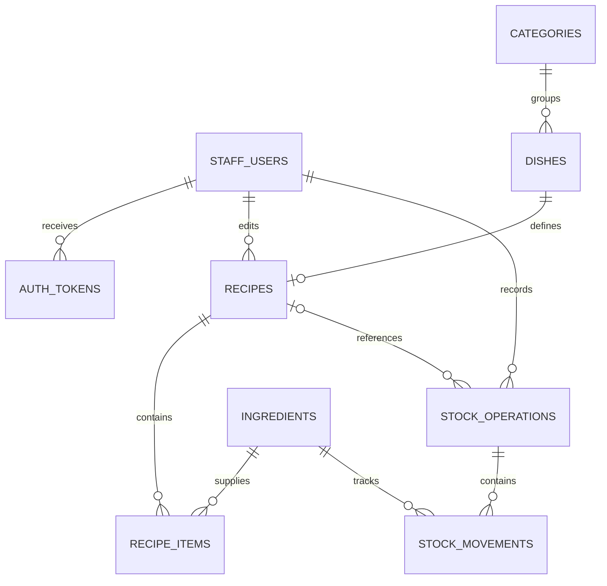

# Database schema — SSR application

This reference describes the ten Prisma models used by `restaurant-mvc` for Blocks 5 and 8. All tables are in PostgreSQL schema `restaurant`. It is derived from the checked-in model and migration files, not an inspection of the live Supabase database. The separate CSR app may have additional columns or indexes in the shared database.

- [Prisma models](../../prisma/schema.prisma): application fields and relations.
- [Versioned migrations](../../prisma/migrations/): authoritative DDL, constraints, triggers and upgrade history.
- [Complete SQL reference](schema.sql): all four migrations in order, including authentication. For an empty database only; do not run it on existing data.

Apply pending migrations with `npm run db:deploy`. Do not edit deployed migrations or use reset to update an existing database. No migration is required solely for this documentation refresh.

## Relationships

Sessions hold serialized application state in `data`; a signed-in session contains `userId` and `sessionVersion`. There is no SQL foreign key from sessions to staff. Anonymous forms also have sessions for CSRF and the verification resend countdown.

## Field reference

`NULL` indicates an optional SQL column. UUID defaults and `@updatedAt` behavior are supplied by Prisma, not database UUID/update triggers. Relation objects/arrays are represented by their foreign-key fields and the diagram rather than additional SQL columns.

### `staff_users` — `StaffUser`

| Column | Prisma field | SQL type | Nullable | Default / key |
| --- | --- | --- | --- | --- |
| `id` | `id` | `UUID` | No | Primary key; Prisma UUID |
| `email` | `email` | `VARCHAR(254)` | No | Unique |
| `password_hash` | `passwordHash` | `TEXT` | No | — |
| `display_name` | `displayName` | `VARCHAR(100)` | No | — |
| `role` | `role` | `VARCHAR(10)` | No | — |
| `is_active` | `isActive` | `BOOLEAN` | No | true |
| `email_verified_at` | `emailVerifiedAt` | `TIMESTAMPTZ` | Yes | — |
| `approval_status` | `approvalStatus` | `VARCHAR(10)` | No | "pending" |
| `session_version` | `sessionVersion` | `INTEGER` | No | 0 |
| `last_login_at` | `lastLoginAt` | `TIMESTAMPTZ` | Yes | — |
| `created_at` | `createdAt` | `TIMESTAMPTZ` | No | CURRENT_TIMESTAMP |
| `updated_at` | `updatedAt` | `TIMESTAMPTZ` | No | CURRENT_TIMESTAMP; Prisma updates timestamp |

### `categories` — `Category`

| Column | Prisma field | SQL type | Nullable | Default / key |
| --- | --- | --- | --- | --- |
| `id` | `id` | `UUID` | No | Primary key; Prisma UUID |
| `name` | `name` | `VARCHAR(100)` | No | — |
| `slug` | `slug` | `VARCHAR(120)` | No | Unique |
| `description` | `description` | `TEXT` | Yes | — |
| `display_order` | `displayOrder` | `INTEGER` | No | 0 |
| `is_active` | `isActive` | `BOOLEAN` | No | true |
| `archived_at` | `archivedAt` | `TIMESTAMPTZ` | Yes | — |
| `created_at` | `createdAt` | `TIMESTAMPTZ` | No | CURRENT_TIMESTAMP |
| `updated_at` | `updatedAt` | `TIMESTAMPTZ` | No | CURRENT_TIMESTAMP; Prisma updates timestamp |

### `dishes` — `Dish`

| Column | Prisma field | SQL type | Nullable | Default / key |
| --- | --- | --- | --- | --- |
| `id` | `id` | `UUID` | No | Primary key; Prisma UUID |
| `category_id` | `categoryId` | `UUID` | No | — |
| `name` | `name` | `VARCHAR(150)` | No | — |
| `slug` | `slug` | `VARCHAR(180)` | No | Unique |
| `description` | `description` | `TEXT` | Yes | — |
| `price_minor` | `priceMinor` | `BIGINT` | No | — |
| `currency` | `currency` | `VARCHAR(3)` | No | "VND" |
| `image_path` | `imagePath` | `TEXT` | Yes | — |
| `image_alt` | `imageAlt` | `VARCHAR(200)` | Yes | — |
| `is_featured` | `isFeatured` | `BOOLEAN` | No | false |
| `is_published` | `isPublished` | `BOOLEAN` | No | false |
| `is_available` | `isAvailable` | `BOOLEAN` | No | true |
| `display_order` | `displayOrder` | `INTEGER` | No | 0 |
| `archived_at` | `archivedAt` | `TIMESTAMPTZ` | Yes | — |
| `created_at` | `createdAt` | `TIMESTAMPTZ` | No | CURRENT_TIMESTAMP |
| `updated_at` | `updatedAt` | `TIMESTAMPTZ` | No | CURRENT_TIMESTAMP; Prisma updates timestamp |

### `ingredients` — `Ingredient`

| Column | Prisma field | SQL type | Nullable | Default / key |
| --- | --- | --- | --- | --- |
| `id` | `id` | `UUID` | No | Primary key; Prisma UUID |
| `name` | `name` | `VARCHAR(150)` | No | Unique |
| `description` | `description` | `TEXT` | Yes | — |
| `base_unit` | `baseUnit` | `VARCHAR(10)` | No | — |
| `quantity_on_hand` | `quantityOnHand` | `NUMERIC(14, 3)` | No | 0 |
| `low_stock_threshold` | `lowStockThreshold` | `NUMERIC(14, 3)` | No | 0 |
| `is_active` | `isActive` | `BOOLEAN` | No | true |
| `archived_at` | `archivedAt` | `TIMESTAMPTZ` | Yes | — |
| `created_at` | `createdAt` | `TIMESTAMPTZ` | No | CURRENT_TIMESTAMP |
| `updated_at` | `updatedAt` | `TIMESTAMPTZ` | No | CURRENT_TIMESTAMP; Prisma updates timestamp |

### `recipes` — `Recipe`

| Column | Prisma field | SQL type | Nullable | Default / key |
| --- | --- | --- | --- | --- |
| `id` | `id` | `UUID` | No | Primary key; Prisma UUID |
| `dish_id` | `dishId` | `UUID` | No | Unique |
| `instructions` | `instructions` | `TEXT` | No | "" |
| `preparation_minutes` | `preparationMinutes` | `INTEGER` | Yes | — |
| `cooking_minutes` | `cookingMinutes` | `INTEGER` | Yes | — |
| `version` | `version` | `INTEGER` | No | 1 |
| `updated_by` | `updatedBy` | `UUID` | No | — |
| `created_at` | `createdAt` | `TIMESTAMPTZ` | No | CURRENT_TIMESTAMP |
| `updated_at` | `updatedAt` | `TIMESTAMPTZ` | No | CURRENT_TIMESTAMP; Prisma updates timestamp |

### `recipe_items` — `RecipeItem`

| Column | Prisma field | SQL type | Nullable | Default / key |
| --- | --- | --- | --- | --- |
| `recipe_id` | `recipeId` | `UUID` | No | — |
| `ingredient_id` | `ingredientId` | `UUID` | No | — |
| `quantity` | `quantity` | `NUMERIC(14, 3)` | No | — |
| `notes` | `notes` | `VARCHAR(250)` | Yes | — |
| `created_at` | `createdAt` | `TIMESTAMPTZ` | No | CURRENT_TIMESTAMP |
| `updated_at` | `updatedAt` | `TIMESTAMPTZ` | No | CURRENT_TIMESTAMP; Prisma updates timestamp |

### `stock_operations` — `StockOperation`

| Column | Prisma field | SQL type | Nullable | Default / key |
| --- | --- | --- | --- | --- |
| `id` | `id` | `UUID` | No | Primary key; Prisma UUID |
| `type` | `type` | `VARCHAR(12)` | No | — |
| `reason` | `reason` | `TEXT` | No | — |
| `recipe_id` | `recipeId` | `UUID` | Yes | — |
| `recipe_version` | `recipeVersion` | `INTEGER` | Yes | — |
| `servings` | `servings` | `INTEGER` | Yes | — |
| `created_by` | `createdBy` | `UUID` | No | — |
| `request_key` | `requestKey` | `UUID` | No | Unique |
| `created_at` | `createdAt` | `TIMESTAMPTZ` | No | CURRENT_TIMESTAMP |

### `stock_movements` — `StockMovement`

| Column | Prisma field | SQL type | Nullable | Default / key |
| --- | --- | --- | --- | --- |
| `id` | `id` | `UUID` | No | Primary key; Prisma UUID |
| `operation_id` | `operationId` | `UUID` | No | — |
| `ingredient_id` | `ingredientId` | `UUID` | No | — |
| `quantity_delta` | `quantityDelta` | `NUMERIC(14, 3)` | No | — |
| `quantity_before` | `quantityBefore` | `NUMERIC(14, 3)` | No | — |
| `quantity_after` | `quantityAfter` | `NUMERIC(14, 3)` | No | — |
| `created_at` | `createdAt` | `TIMESTAMPTZ` | No | CURRENT_TIMESTAMP |

### `sessions` — `Session`

| Column | Prisma field | SQL type | Nullable | Default / key |
| --- | --- | --- | --- | --- |
| `sid` | `sid` | `VARCHAR(36)` | No | Primary key |
| `data` | `data` | `TEXT` | No | — |
| `expires` | `expires` | `TIMESTAMPTZ` | No | — |
| `created_at` | `createdAt` | `TIMESTAMPTZ` | No | CURRENT_TIMESTAMP |
| `updated_at` | `updatedAt` | `TIMESTAMPTZ` | No | CURRENT_TIMESTAMP; Prisma updates timestamp |

### `auth_tokens` — `AuthToken`

| Column | Prisma field | SQL type | Nullable | Default / key |
| --- | --- | --- | --- | --- |
| `id` | `id` | `UUID` | No | Primary key; Prisma UUID |
| `user_id` | `userId` | `UUID` | No | — |
| `purpose` | `purpose` | `VARCHAR(10)` | No | — |
| `token_hash` | `tokenHash` | `VARCHAR(64)` | No | Unique |
| `expires_at` | `expiresAt` | `TIMESTAMPTZ` | No | — |
| `used_at` | `usedAt` | `TIMESTAMPTZ` | Yes | — |
| `created_at` | `createdAt` | `TIMESTAMPTZ` | No | CURRENT_TIMESTAMP |

## Keys, indexes and deletion rules

| Table | Additional indexes / keys | Foreign keys |
| --- | --- | --- |
| staff_users | Unique email | None |
| categories | Unique slug | None |
| dishes | Unique slug; category_id + is_published | category_id → categories.id (RESTRICT) |
| ingredients | Unique name | None |
| recipes | Unique dish_id | dish_id → dishes.id; updated_by → staff_users.id (both RESTRICT) |
| recipe_items | Composite primary key (recipe_id, ingredient_id); ingredient_id index | recipe_id → recipes.id; ingredient_id → ingredients.id (both RESTRICT) |
| stock_operations | Unique request_key; created_at index | recipe_id → recipes.id (nullable); created_by → staff_users.id (both RESTRICT) |
| stock_movements | Unique (operation_id, ingredient_id); (ingredient_id, created_at) index | operation_id → stock_operations.id; ingredient_id → ingredients.id (both RESTRICT) |
| sessions | expires index | None |
| auth_tokens | Unique token_hash; (user_id, purpose, created_at); expires_at | user_id → staff_users.id (CASCADE) |

## Authentication state

- `role`: `admin` or `chef`. Public registration always writes `chef`.
- `approval_status`: `pending`, `approved` or `rejected`; new rows default to `pending`.
- `email_verified_at`: null until email verification succeeds. Access requires verification, approval and `is_active=true`.
- `session_version`: incremented on password reset and staff access changes. Requests compare it to the version in the stored session.
- `auth_tokens.purpose`: `verify` or `reset`. Only SHA-256 hashes are stored; links contain random single-use tokens. Verification expires after 24 hours; password reset after 30 minutes.
- Sessions and expired tokens are pruned by the server cleanup timer. Password reset deletes existing signed-in session records and increments the version to invalidate any concurrent stale session.

Migration `202611020001_staff_auth` marks pre-existing staff as verified and approved to preserve access. It leaves inactive accounts inactive. New chef registrations require both verification and approval; admin-provisioned chefs are approved but still need verification. The initial administrator is provisioned as verified and approved.

## Inventory integrity

Prices use integer VND in BIGINT; quantity calculations use NUMERIC(14,3). CHECK constraints enforce nonnegative stock/prices, positive recipe quantities, valid units (`g`, `ml`, `piece`), roles, approval states and token purposes. Stock types are `receipt`, `usage`, `waste` and `correction`.

Movement checks require a nonzero delta, nonnegative balances and `quantity_after = quantity_before + quantity_delta`. Triggers enforce signs by operation type, immutable stock history and stable units for referenced ingredients. Recipe-based usage must supply recipe ID, version and positive servings together. UUID request keys make repeated stock submissions idempotent.

Catalog deletion is archival, and staff removal deactivates access. Stock history remains intact. Prisma cannot express every CHECK or trigger: consult migration SQL for the full definitions.

## Migration history

| Migration | Purpose |
| --- | --- |
| 202610120001_initial | Original nine-table restaurant schema |
| 202610120002_integrity | Domain checks, inventory triggers and private-schema access restrictions |
| 202610120003_recipe_allocation_check | Require all recipe allocation fields together |
| 202611020001_staff_auth | Verification, approvals, session invalidation and auth token table |
