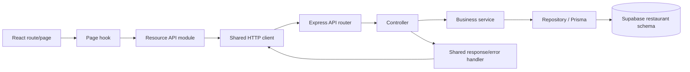

# 三太子亭 — Santaishi-tei · Block 6

A client-side rendered restaurant application built with JavaScript, React, React Router, Express, Prisma and Supabase PostgreSQL. Public visitors browse the restaurant and menu. Authenticated chefs and administrators manage dishes, recipes and inventory.

## Relationship to Block 5

`restaurant-csr` is a separate application beside `restaurant-mvc`. It shares the PostgreSQL `restaurant` schema with Block 5. Block 6 adds an optional `preparation_summary` column to dishes; Block 5 can continue using its existing fields. **Both applications access the same business records when configured with the same database.** A change to a dish, ingredient or chef in either application is visible to the other. The public preparation-summary migration is additive and backfills known dish stories without changing existing fields. It has been applied to the configured exercise database; setup on another Block 5 database requires `npm run db:migrate:summary`.

The React application uses its own cookie name, `restaurant.csr.sid`, while storing sessions in the existing `restaurant.sessions` table. Existing staff credentials remain valid. This project does not create real staff accounts automatically.

| Block 5 | Block 6 |
|---|---|
| EJS server-rendered pages | React renders the application in the browser |
| HTML form POST and HTTP 303 PRG | JSON requests and response envelopes |
| POST form method override | Actual HTTP PATCH, PUT and DELETE |
| Document navigation between pages | React Router and browser History API |
| HTML controllers | JSON API controllers with shared response handling |

## Local setup

Requirements: Node.js 24 or later and npm.

Run commands inside `restaurant-csr`:

```sh
npm ci
npm run db:generate
npm run dev
```

Before starting, fill in the local ignored `.env` file. A placeholder file is created for initial setup; it contains no real credentials. `.env.example` documents the settings.

| Variable | Development value |
|---|---|
| `DATABASE_URL` | Existing Supabase Session pooler PostgreSQL URI |
| `SESSION_SECRET` | A newly generated random secret of at least 32 characters |
| `NODE_ENV` | `development` |
| `PORT` | `3001` for the API |
| `APP_ORIGIN` | `http://localhost:3000` |

Open **http://localhost:3000**. Vite forwards `/api` requests to Express at `127.0.0.1:3001`. Stop any other local application occupying those ports first. Ctrl+C stops both development processes. Vite is configured not to load environment files, and browser code receives no database credentials.

Sign in with an existing Block 5 administrator or chef account. `npm run admin:create` is available only for a database without an administrator; it does not replace an existing account. Do not run database reset, migration or seed commands against the shared database as part of this conversion.

## Architecture



- `client/src/pages/`: route content, forms and UI state; no direct HTTP calls.
- `client/src/hooks/`: route data fetching, cancellation and mutation locks.
- `client/src/api/`: centralized API root, headers, CSRF, credentials and three-layer error handling.
- `client/src/components/`: navigation, full-screen shoji panels, loading indicator and shared controls.
- `src/routes/`, `src/controllers/`: HTTP resources, role checks and response orchestration.
- `src/services/`, `src/models/`: business rules, inventory transactions, sessions and database access.
- `prisma/`: shared business models, Block 5 migration history and the additive Block 6 public-summary migration.
- `tests/`: isolated PostgreSQL-compatible fixtures and API/client contract tests.

Only the session is checked at application startup. Each route requests its own data when opened. Intro and directory pages require no business-data API call. Menu search, sorting and page numbers are stored in the URL. Browser Back/Forward and direct frontend URLs are supported.

During HTTP requests, a visible status indicator appears, a disabled fieldset locks form controls/buttons, and `inert` locks links and keyboard interaction. Requests have a timeout; route changes abort obsolete reads. Mutations are not automatically retried. Stock forms retain a request key for retries of the same submission to prevent duplicate movements.

## Features and permissions

| Feature | Public | Chef | Admin |
|---|---|---|---|
| Restaurant intro, directory and menu | Yes | Yes | Yes |
| Dish and recipe management | No | Yes | Yes |
| Pantry and stock journal | No | Yes | Yes |
| Record usage or waste | No | Yes | Yes |
| Ingredient/category management | No | No | Yes |
| Record receipts or corrections | No | No | Yes |
| Chef account management | No | No | Yes |

Archiving preserves records and history; no restore UI is included. Removing a chef disables access. Recipe saves do not deduct stock. Recipe usage deducts saved per-serving quantities atomically, and insufficient stock rejects the entire operation. Corrections accept signed differences, not target balances.

The interface retains Japanese scene backgrounds, floor arrows, the menu book, dish dialogs, kitchen tickets and paper-styled recipe forms. Full-screen shoji panels accompany cross-room links. Same-room routes use ordinary client-side navigation. Reduced-motion preferences bypass movement.

## API contract

See [API reference](docs/api.md) for routes, payloads and error codes.

Success: HTTP 200 with `{ "ok": true, "data": ... }`. Mutations return the saved record. Expected business failures: HTTP 200 with `{ "ok": false, "error": { "code": "...", "message": "...", "fields": {} } }`; `fields` is omitted unless input fields have errors. Authentication/authorization failures use HTTP 401/403. Unexpected failures use HTTP 500. An unknown API endpoint uses JSON HTTP 404.

The client distinguishes network failures, HTTP/protocol failures and application failures. It branches on stable `error.code` values, never message wording. Data is validated against writable-field schemas; secrets and password hashes are not returned. Monetary BigInt values and inventory decimals are serialized as strings.

## Verification and disposable preview

To populate the configured database with optional presentation recipes and inventory journals, see [Demo data](docs/demo-data.md). The import is explicit, preserves existing records and is safe to rerun.

```sh
npm test
npm run preview:fixture
```

Tests generate Prisma Client, build React, and run against an isolated in-memory PGlite database. They do not load `.env` or connect to Supabase. The preview serves the production build at **http://127.0.0.1:3003** and is also isolated. Run `npm run build` first if not already built. All fixture changes disappear when it stops.

Preview-only accounts:

- `admin@example.test`
- `chef@example.test`
- Password for both: `Fixture-only-passphrase-2026`

These accounts exist only in the disposable preview, never in the shared Supabase database.

For loading-state checks, run `npm run preview:fixture -- --slow --trace`. This adds a short delay to API responses and logs request methods and paths without request bodies or credentials. See [verification results](docs/verification.md).

## Production

```sh
npm ci --include=dev
npm run db:generate
npm run build
npm start
```

Configure server-side environment variables through the hosting provider: `NODE_ENV=production`, the public HTTPS `APP_ORIGIN`, `DATABASE_URL`, `SESSION_SECRET` and the platform-provided `PORT`. Express binds to `0.0.0.0` in production, serves the React build and API from one origin, trusts one reverse-proxy hop and uses secure session cookies. Use a Node-capable host. API requests never fall through to the SPA HTML fallback.
