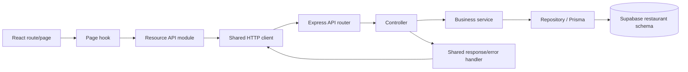

# 三太子亭 — Santaishi-tei

A Japanese restaurant website and staff workspace developed for Blocks 6 and 7. React renders the interface in the browser, while an Express REST API uses Prisma to access Supabase PostgreSQL.

Visitors explore the restaurant, browse dishes and view public ingredient information. Chefs maintain dishes and recipes and record ingredient usage or waste. Administrators additionally manage ingredients, categories, stock receipts, corrections and chef accounts. Customer accounts, ordering and reservations are outside the project's scope.

## 1. Choose how to run the application

There are two ways to run the website:

| Mode | Best for | Database and accounts |
|---|---|---|
| Disposable demo | Trying the interface, animations and pagination without credentials | Temporary local database with demo accounts; changes disappear on shutdown |
| Development with Supabase | Working with the restaurant's persistent data | Requires private configuration and an existing staff account |

Both modes require **Node.js 24 or later**, npm and the complete repository, including `public/` and `package-lock.json`. Use a current browser with JavaScript enabled.

Run every command below from the **`restaurant-csr` directory**, where this application's `package.json` is located—not the parent repository or `restaurant-mvc`.

```sh
cd restaurant-csr
node --version
npm --version
```

If the terminal is already inside `restaurant-csr`, skip the `cd` command.

## 2. Quick start: disposable demo

This is the easiest setup for a classmate who wants to review the website without access to Supabase.

```sh
npm ci
npm run db:generate
npm run build
npm run preview:fixture -- --large
```

Open **http://127.0.0.1:3003**. Keep the terminal running; press **Ctrl+C** to stop the server.

The `--large` option adds 1,200 temporary demo dishes for pagination and search. This preview does not load `.env`, connect to Supabase or modify shared records.

| Preview account | Email | Password |
|---|---|---|
| Administrator | `admin@example.test` | `Fixture-only-passphrase-2026` |
| Chef | `chef@example.test` | `Fixture-only-passphrase-2026` |

These accounts exist **only in the disposable preview**. They cannot sign in to the Supabase-backed application.

The preview serves a built version of the frontend. After editing frontend files, run `npm run build` again and refresh the browser. For automatically refreshed frontend development, use the Supabase setup below.

## 3. Development with Supabase

### Install dependencies and generate Prisma Client

After cloning the repository:

```sh
npm ci
npm run db:generate
```

- **`npm ci`** installs the exact versions in `package-lock.json`. Run it on first setup and when dependency versions change. It replaces the local `node_modules` directory; it does not change restaurant records.
- **`npm run db:generate`** generates Prisma Client from `prisma/schema.prisma`. Run it after installation and after pulling schema changes. It does not create tables or apply migrations, and does not require database credentials.
- **Migration commands** change the database structure. They are a separate setup step, not something each teammate should run whenever the website starts.

Use the project's npm commands rather than an arbitrary `npx prisma` command. In particular, Prisma's configuration does not automatically load `.env` for direct CLI calls.

### Configure the private environment

Create a file named `.env` inside `restaurant-csr` using a text editor. If it already exists, edit it without replacing its contents. Environment files are ignored by Git, so cloning the repository does not provide credentials.

Use these settings, replacing placeholder values privately:

```dotenv
NODE_ENV=development
PORT=3001
APP_ORIGIN=http://127.0.0.1:3000
DATABASE_URL="YOUR_SUPABASE_POSTGRESQL_CONNECTION_URI"
SESSION_SECRET="YOUR_RANDOM_SECRET_AT_LEAST_32_CHARACTERS"

# Needed for photo uploads:
SUPABASE_URL="YOUR_SUPABASE_PROJECT_URL"
SUPABASE_SECRET_KEY="YOUR_SERVER_ONLY_SUPABASE_SECRET_KEY"
SUPABASE_STORAGE_BUCKET=dish-photos

# Needed only when deploying database migrations:
MIGRATION_DATABASE_URL="YOUR_MIGRATION_CONNECTION_URI_WITH_SCHEMA_RESTAURANT"
```

`DATABASE_URL` is a PostgreSQL connection URI, not the Supabase project URL or an API key. Use the project's Session pooler connection details for the existing setup. Obtain credentials from the project owner privately. URL-encode special characters in a database password when placing it in a URI.

Generate a session secret locally with:

```sh
node -e "console.log(require('node:crypto').randomBytes(32).toString('hex'))"
```

Store the result in `.env`, not in source code. Do not share screenshots containing secrets. Never prefix server secrets with `VITE_`; Vite is configured not to read this project's environment files.

Storage settings are required for photo uploads, not for displaying existing local images. The legacy `SUPABASE_SERVICE_ROLE_KEY` is supported instead of `SUPABASE_SECRET_KEY`. `SUPABASE_STORAGE_BUCKET` is a bucket **name**, not another key; it defaults to `dish-photos`. See [photo upload configuration](docs/photo-uploads.md).

### Prepare the database only when necessary

**Using the team's existing exercise database:** its migrations have already been applied. Skip database creation and seeding. Existing staff credentials remain valid; the application does not automatically create real accounts.

**Updating an existing restaurant database:** the database owner can deploy pending migrations with:

```sh
npm run db:migrate:search
```

This wrapper privately loads server configuration, deploys pending Prisma migrations and compares restaurant records before and after. It expects existing restaurant tables. It is not the initialization command for an empty database.

**Using a new, empty database:** configure `MIGRATION_DATABASE_URL` with the connection intended for migrations and the query parameter `schema=restaurant`. Use `?schema=restaurant` if the URI has no query string, or `&schema=restaurant` if it already has one. Then run:

```sh
node --env-file=.env scripts/prisma.js migrate deploy
npm run admin:create
```

The first command explicitly loads local configuration and applies the checked-in migration history. The second prompts for the first administrator's name, email and a password of at least 12 characters. It will not replace an existing administrator. Create chef accounts through the administrator interface afterward.

An empty database does not contain the team's menu or inventory. Add categories and dishes through the application, or review the optional [inventory demo import](docs/demo-data.md) and [pagination demo import](docs/block7-demo-dishes.md), including their prerequisites. Imports write records; they are not required to start the server.

Do not use `prisma migrate reset` or `prisma db push` on the shared exercise database. If tables exist without the expected migration history, resolve that history with the database owner before applying migrations.

### Start the application

```sh
npm run dev
```

Open **http://127.0.0.1:3000**. This starts both processes:

| Process | Port | Purpose |
|---|---|---|
| Vite | `3000` | Serves React and frontend assets |
| Express | `3001` | Serves `/api` and connects to Supabase |

Vite forwards `/api` requests to `127.0.0.1:3001`. Keep `PORT=3001` for this development configuration. Use the same hostname consistently when signing in; `localhost` and `127.0.0.1` have separate browser cookies. If using `http://localhost:3000`, set `APP_ORIGIN` to that address instead.

Wait for both Vite's startup URL and the API's listening message. A Vite URL alone does not mean the database connection succeeded. Keep the terminal open and use **Ctrl+C** to stop both processes. Restart after changing `.env`.

For later runs, normally only `npm run dev` is needed. After pulling updates, rerun `npm ci` if dependencies changed and `npm run db:generate` if the Prisma schema changed.

## 4. Troubleshooting startup and animations

| Symptom | What to check |
|---|---|
| `vite`, `concurrently` or a package cannot be found | Confirm the current folder is `restaurant-csr`, then run `npm ci`. |
| Prisma Client is missing or outdated | Run `npm run db:generate`, then restart. Generating the client does not repair a database connection. |
| Configuration error mentions `DATABASE_URL` or `SESSION_SECRET` | Check the local `.env` location and values. The secret must contain at least 32 characters. |
| Vite starts but API/database startup fails | Check that Supabase is active, the connection URI is correct, the network can reach it, and migrations are applied. Share only sanitized error messages. |
| Port 3000 or 3001 is already in use | Stop the earlier development server or conflicting local application. Vite uses a strict port and will not silently choose another. |
| Browser shows repository files or an unstyled page | Open the application's startup URL. Do not use VS Code Live Server, open `client/index.html` directly, or browse the repository directory as a static website. |
| Login works on one URL but not another | Keep the hostname consistent, verify `APP_ORIGIN`, and use real staff credentials for Supabase or fixture credentials for the demo. |
| Changes do not appear in the disposable preview or production build | Run `npm run build` again and refresh. `npm run dev` handles frontend updates automatically. |
| Photo upload fails but browsing works | Check the server-only Storage settings and [upload guide](docs/photo-uploads.md). |

### When animations should appear

- **Room transition:** click an internal link between rooms, such as the house and dining room. Full-screen shoji panels accompany cross-room navigation. Same-room navigation intentionally does not use them. Directly entering a URL, refreshing, opening a new tab or using browser history does not reproduce the same link-click transition.
- **Menu page flip:** select **Page numbers** and move to a different results page. Load more and infinite scrolling append dishes without a page-flip animation. A menu with only one page cannot demonstrate flipping.
- **Reduced motion:** JavaScript and CSS intentionally suppress movement when the browser reports `prefers-reduced-motion: reduce`. This can follow an operating-system accessibility preference or a browser developer-tools override. If reduced motion is needed, keep it enabled—the application remains usable without movement. Otherwise, check that preference when comparing the animation with another device.

To check the reported motion preference, run this read-only expression in the browser's developer console:

```js
window.matchMedia('(prefers-reduced-motion: reduce)').matches
```

`true` means reduced motion is active. It does not indicate a missing package or a Prisma problem.

If backgrounds or transitions are still missing:

1. Confirm the entire repository was obtained, including `public/css/` and `public/images/japan/`. These assets are tracked in Git; no image-generation step is required.
2. Refresh the correct application URL. For a built preview, rebuild first.
3. Inspect the browser Network tab for failed CSS or image requests, and the Console for JavaScript errors. Record the failing filename/status and browser version without exposing credentials.
4. Try the disposable demo to separate frontend issues from database/account configuration. Report the exact route and action that should trigger the animation.

## 5. Features and permissions

| Feature | Public | Chef | Admin |
|---|---|---|---|
| Restaurant scenes, menu and public dish details | Yes | Yes | Yes |
| Dish and internal recipe management | No | Yes | Yes |
| Pantry and stock journal | No | Yes | Yes |
| Record usage or waste | No | Yes | Yes |
| Ingredient/category management | No | No | Yes |
| Record receipts or corrections | No | No | Yes |
| Chef account management | No | No | Yes |

Archiving preserves records and history; there is no restore interface. Removing a chef disables access. Recipe saves do not deduct stock. Recording recipe usage deducts per-serving quantities atomically; insufficient stock rejects the entire operation. Corrections represent signed differences, not target balances.

Dining and kitchen support server-side pagination, filtering and sorting. Search runs on Enter or the Search button. Full-text, prefix and fuzzy matching support dish discovery; fuzzy matching is approximate, not a guarantee that every misspelling will match. Internal recipe instructions remain staff-only.

All three pagination modes share a compact floating toolbar. Infinite scroll fetches one batch at a time while the end remains visible; Pause/Resume and mode switching remain available. Errors stop automatic loading and provide Retry. Search, filters, sort order, mode and batch are preserved in bookmark URLs. A bookmarked Load more/infinite page fetches its saved batch directly rather than downloading all preceding batches.

## 6. Architecture and API



| Directory | Responsibility |
|---|---|
| `client/src/pages/` | Route content and forms |
| `client/src/hooks/` | Page data, cancellation and pagination state |
| `client/src/api/` | Central API root, headers, CSRF and error handling |
| `client/src/components/` | Shared controls, dialogs and transitions |
| `src/routes/`, `src/controllers/` | HTTP resources, permissions and responses |
| `src/services/`, `src/models/` | Business rules, inventory transactions and database access |
| `prisma/` | Schema and checked-in SQL migrations, including search indexes |
| `public/` | Shared styles, scene backgrounds and local dish images |
| `tests/` | Isolated API, client and database tests |

Each route loads its own data. Dish queries use database limits and offsets; the server does not return the full catalog for client-side paging. Dish-list reads run in the background so browsing remains interactive. Other requests retain loading protection; obsolete reads are cancelled. Mutations are not automatically retried, and stock submissions use request keys to prevent duplicate movements.

The REST API returns:

- Success: HTTP 200, `{ "ok": true, "data": ... }`; mutations return the saved record.
- Expected business errors: HTTP 200, `{ "ok": false, "error": { "code": "...", "message": "..." } }`. `fields` is included only for input-specific errors.
- Authentication/authorization errors: HTTP 401/403.
- Unexpected errors: HTTP 500. Unknown API endpoints: JSON HTTP 404.

The client distinguishes network, HTTP/protocol and application failures and branches on stable error codes. APIs accept only permitted fields and do not expose credentials or password hashes. Monetary BigInt values and inventory decimals are serialized as strings. See the [API reference](docs/api.md).

### Relationship to Blocks 5–7

`restaurant-csr` sits beside the Block 5 `restaurant-mvc` application. Block 6 replaced EJS pages, HTML form redirects and method override with React, History API navigation and actual JSON PATCH/PUT/DELETE requests. Block 7 extends the same CSR folder with pagination, search, filters and indexes.

When configured for the same Supabase database, both applications share business records in the `restaurant` schema. Changes in either application affect that shared data. CSR uses its own `restaurant.csr.sid` cookie and the existing sessions table. The public preparation-summary column and search indexes are additive migrations.

## 7. Verification and production

Run the automated suite with:

```sh
npm test
```

It generates Prisma Client, builds React and runs tests against an isolated PGlite database with mocked Storage. Tests do not load `.env` or connect to Supabase.

For a deliberately slow disposable demo:

```sh
npm run build
npm run preview:fixture -- --large --slow --trace
```

The trace logs request methods and paths without credentials or request bodies.

For a production build on a Node-capable host:

```sh
npm ci --include=dev
npm run db:generate
npm run build
npm start
```

Configure `NODE_ENV=production`, the public HTTPS `APP_ORIGIN`, database/session/Storage settings and the host's `PORT`. Apply required migrations separately before serving traffic. Express binds to `0.0.0.0`, serves React and the API from one origin, trusts one reverse-proxy hop and uses secure cookies. This full-stack application cannot run on GitHub Pages alone.

## Further documentation

- [Pagination, search, indexes and bookmark behavior](docs/block7-pagination.md)
- [Pagination demo dishes](docs/block7-demo-dishes.md)
- [Recipes and inventory demo data](docs/demo-data.md)
- [Photo uploads and publication](docs/photo-uploads.md)
- [REST API reference](docs/api.md)
- [Earlier verification notes](docs/verification.md)
- [Presentation materials](presentation/README.md)
