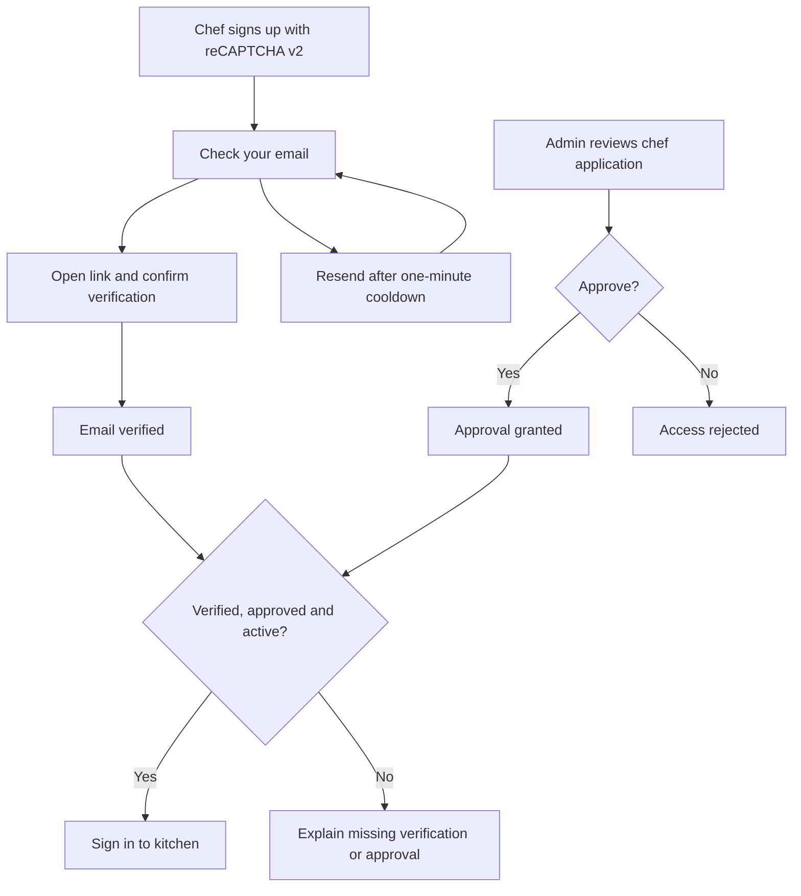

# 三太子亭 — Santaishi-tei

A Japanese restaurant website and staff workspace by **Tam Thái Tử**. This folder contains the **SSR application from Block 5, extended with staff authentication for Block 8**. The separate `restaurant-csr` project contains the React exercises from Blocks 6–7.

Customers browse the restaurant and published menu without accounts. Chefs maintain dishes and recipes and record ingredient usage or waste. Administrators manage the catalog, stock receipts/corrections and chef access. Ordering, reservations and customer accounts are outside this application's scope.

## Start the application

Use Node.js 24 or later and npm. Run commands from this folder:

```sh
npm ci
npm run db:generate
npm run db:deploy
npm run dev
```

Before starting, create a private `.env` using `.env.example` as a reference, or retain the existing configuration. Never commit credentials or replace an existing environment file with the template.

| Settings | Purpose |
| --- | --- |
| `DATABASE_URL` | Runtime PostgreSQL connection, such as Supabase's Session pooler |
| `MIGRATION_DATABASE_URL` | Direct or Session pooler PostgreSQL connection for migrations |
| `SESSION_SECRET` | Random session-signing secret, at least 32 characters |
| `APP_ORIGIN` | Origin used in email links and CAPTCHA hostname checks; locally `http://localhost:3000` |
| `PORT`, `NODE_ENV` | Default port 3000 and development mode; production requires HTTPS |
| `SMTP_HOST`, `SMTP_PORT`, `SMTP_SECURE` | Email server and TLS configuration |
| `SMTP_USER`, `SMTP_PASSWORD`, `SMTP_FROM` | SMTP credentials and sender address |
| `RECAPTCHA_SITE_KEY`, `RECAPTCHA_SECRET_KEY` | Google reCAPTCHA **v2 checkbox** keys |

Follow [the authentication setup guide](docs/block8-authentication.md) for Gmail App Passwords, SMTP alternatives, reCAPTCHA and an end-to-end demonstration. Missing CAPTCHA configuration disables registration; existing staff sign-in remains available. Real email delivery needs working SMTP credentials.

Open [http://localhost:3000](http://localhost:3000). Use the same hostname consistently for browsing, CAPTCHA and email links. `npm start` starts without file watching. Keep the server terminal open; Ctrl+C stops the server and disconnects Prisma.

The application serves pages through Express, not VS Code Live Server. If another process occupies port 3000, stop that process or choose another port and matching `APP_ORIGIN`. Register the hostname with reCAPTCHA. Startup failures suppress connection details to avoid exposing credentials.

## Database and initial administrator

Prisma migrations create application tables in the private PostgreSQL `restaurant` schema. Select that schema in Supabase when inspecting tables. `npm run db:deploy` applies pending versioned migrations; it does not reset the database. Do not execute the complete SQL reference on an existing database.

Create the first admin with `npm run admin:create`, which prompts for credentials, or use `/setup` locally in development. Setup is restricted to loopback and closes after the first administrator exists. There are no default staff passwords.

Existing staff accounts are grandfathered as verified and approved by the Block 8 migration; existing deactivated accounts remain inactive. The migration preserves restaurant data. This repository's migration files describe intended schema state, not proof that a particular remote database has been migrated.

Optional sample records:

```sh
npm run db:seed
node scripts/seed-japanese-menu.js
```

Seed scripts preserve existing records. The basic seed creates a small sample catalog and ingredients with zero stock, not staff credentials. Record stock receipts before recording usage.

## Registration and access workflow



Verification and approval can happen in either order; both are required. A correct-password login by an unverified chef offers a resend link. A verified chef awaiting approval sees only the approval message. The default login page stays uncluttered.

Forgot password sends a single-use reset link valid for 30 minutes. Verification links last 24 hours. Resend requests have a one-minute cooldown, and authentication endpoints are rate limited. Password reset invalidates existing sessions and never grants approval.

The browser stores a signed session ID in an HttpOnly, SameSite cookie. Session contents persist in PostgreSQL. Login rotates the ID; logout destroys the session. Normal sessions have an eight-hour inactivity window; Remember me extends it to 30 days. Secure cookies are enabled in production. Each authenticated request rechecks the account's role, active/approval/verification state and session version.

## Features and permissions

| Feature | Visitor | Chef | Admin |
| --- | --- | --- | --- |
| Introduction, menu search/filter/sort, dish details | Yes | Yes | Yes |
| Create, edit or archive dishes; maintain recipes | — | Yes | Yes |
| View pantry, ingredient ledgers and stock journal | — | Yes | Yes |
| Record ingredient usage, recipe usage and waste | — | Yes | Yes |
| Receive stock and record signed corrections | — | — | Yes |
| Manage categories and ingredient metadata | — | — | Yes |
| Approve/reject, provision, edit or deactivate chefs | — | — | Yes |

Public registration always creates a chef, never an admin. Admin-provisioned chefs still verify their email. Permissions are enforced on the server regardless of visible buttons. Saving a recipe changes its specification; it does not deduct stock. Recording usage or waste changes balances and writes the journal atomically.

The Japanese interface includes a menu book, page turns, a kitchen ticket board, paper recipe forms, pantry views and full-screen shoji transitions between rooms. Same-room navigation remains normal. See [visual design](docs/design.md).

## Architecture and folder structure

JavaScript, Express, EJS, Prisma and PostgreSQL form the SSR/MVC stack. Nodemailer handles SMTP; Google verifies reCAPTCHA v2 responses. Argon2 hashes passwords. Browser JavaScript enhances server-rendered menu pages, dialogs and countdowns.

```text
restaurant-mvc/
├── README.md                  Setup and current application overview
├── docs/                      Current guides, routes and database reference
│   └── database/              Field reference and complete SQL export
├── prisma/
│   ├── schema.prisma          Ten application models
│   └── migrations/            Versioned SQL migrations
├── scripts/                   Prisma wrapper, admin provisioning and seeds
├── src/
│   ├── config/                Runtime configuration and database connection
│   ├── routes/                HTTP routes
│   ├── middleware/            CSRF, authentication and permissions
│   ├── controllers/           Request handling and rendering
│   ├── services/              Business rules, mail and transactions
│   ├── models/                Repository and database session store
│   ├── validators/            Input validation
│   ├── views/                 EJS pages and partials
│   └── lib/                   Errors and server lifecycle
├── public/                    Styles, browser enhancements and artwork
├── tests/                     Isolated database and HTTP regression tests
└── presentation/              Historical Block 5 presentation
```

The [route reference](docs/routes.md) describes current endpoints. [Database documentation](docs/database/README.md) lists every scalar field, SQL type, relationship, index and migration. Prisma models and migration SQL remain authoritative; the Block 5 presentation is not the current schema reference.

## HTTP and data integrity

- Successful HTML form mutations use **HTTP 303 Post/Redirect/Get**. Refreshing the resulting page does not repeat the mutation.
- GET is read-only. Archive/deactivation forms use POST with `_method=DELETE`; only POST-body overrides are accepted. Mutations require CSRF tokens.
- Validation uses 422, conflicts 409, forbidden actions 403 and missing resources 404. Unauthenticated mutations return 401; protected GET requests redirect to login. Unexpected operational failures use sanitized errors.
- Prices are integer VND; stock uses exact decimal quantities. Stock transactions write balances, operations and movements together, with locks and idempotency keys.
- Recipe versions reject stale edits. SQL checks/triggers prevent invalid quantities, inconsistent movement math, mutable stock history and changes to referenced ingredient units.
- Archiving preserves historical data. Password-reset and verification tokens are stored as hashes and consumed atomically.

The backend accesses PostgreSQL directly. It does not use Supabase Auth or require a Supabase API key. The separate CSR app has its own authentication implementation: do not use it as an alternate staff entrance for Block 8, because it does not enforce these new approval rules.

## Validation and maintenance

```sh
npm test
node node_modules/prisma/build/index.js validate --config prisma.local.config.js
```

The current suite has **62 passing tests** (verified 2 November 2026). It covers verification and resend, approval, password reset, session persistence, SSR, CSRF, permissions, PRG, DELETE overrides, recipes, stock integrity and room transitions. Tests use isolated PGlite and mock email/CAPTCHA providers; they do not read `.env`, send real mail or modify Supabase. The local Prisma config also avoids environment-file loading.

The test fixture serializes database transactions on one connection. Real SMTP delivery, Google's interactive challenge and production concurrency require separate checks. Production requires HTTPS, reviewed proxy settings and restricted database credentials.

Create a new versioned migration for schema changes; do not modify deployed migrations. SQL constraints and triggers that Prisma cannot express belong in migration SQL. The server periodically prunes expired sessions and authentication tokens.

Most staff lists are limited to 100 records; ingredient ledgers show the latest 30 movements. The public menu pages published dishes. Images use controlled local paths. Uploads, suppliers, expiry batches and multiple restaurant locations remain outside this SSR application's scope.

See [the documentation index](docs/README.md) for all guides and the [artwork record](public/images/japan/ASSETS.md) for asset provenance.
