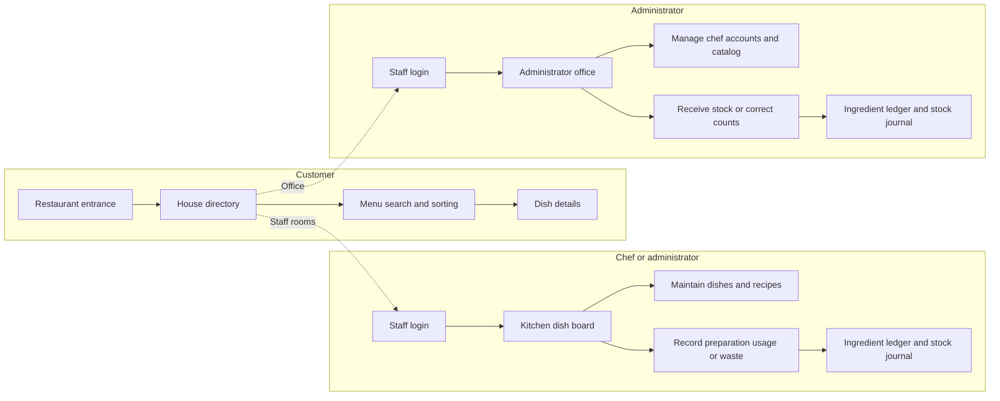

# 三太子亭 — Santaishi-tei

A restaurant introduction website and staff management application developed by **Tam Thái Tử** for a database coursework exercise. The public website presents a Japanese restaurant and its menu. Staff tools support dish management, recipes, ingredient stock and chef administration.

The application uses JavaScript, server-side rendering (SSR), the Model–View–Controller (MVC) pattern, Prisma ORM and Supabase PostgreSQL. Successful form mutations follow Post/Redirect/Get (PRG).

## Features

| Area | Features |
| --- | --- |
| Entrance and house | Shoji entrance door, room directory and floor-arrow navigation |
| Public menu | Search, category filters, name/price sorting, four dishes per spread, page turns and dish details |
| Kitchen | Dish ticket board, dish creation/editing/archiving and paper-style recipe forms |
| Pantry | Ingredient shelf/list views, low-stock filters, balances, recipe references and stock ledgers |
| Stock journal | Receipts, recipe usage, manual usage, waste and signed stock corrections |
| Administrator office | Chef account creation, profile updates and access deactivation |

Customers browse without accounts. Ordering, reservations and customer registration are outside the project scope. The kitchen board displays dishes rather than customer orders.

## Application workflow



Staff routes require an authenticated, active account with the appropriate role. Saving a recipe changes its per-serving specification. Recording usage or waste changes stock and creates ledger entries. Administrators can also receive stock and record corrections.

## Permissions

| Action | Customer | Chef | Administrator |
| --- | --- | --- | --- |
| Browse introduction and published dishes | Yes | Yes | Yes |
| Create, edit or archive dishes | — | Yes | Yes |
| View and edit recipes | — | Yes | Yes |
| View ingredient balances and stock history | — | Yes | Yes |
| Record usage or waste | — | Yes | Yes |
| Receive stock or correct counts | — | — | Yes |
| Manage categories and ingredient metadata | — | — | Yes |
| Create, update or deactivate chef accounts | — | — | Yes |

The server enforces permissions independently of visible interface controls. Each authenticated request reloads the account's active status and role, so deactivation takes effect on the next request.

## Requirements and installation

Requirements: **Node.js 24 or later**, npm, and a Supabase PostgreSQL connection suitable for a persistent Node.js server. Commands run from the `restaurant-mvc` directory.

1. Install dependencies with `npm ci`.
2. For a new installation, create a local `.env` using `.env.example` as the reference. Retain existing configuration. Environment files remain excluded from version control.

   | Variable | Purpose |
   | --- | --- |
   | `DATABASE_URL` | Runtime PostgreSQL connection. Supabase Session pooler access suits the persistent Express server. |
   | `MIGRATION_DATABASE_URL` | PostgreSQL connection for Prisma migrations, using direct or Session pooler access. |
   | `SESSION_SECRET` | Secure random session secret containing at least 32 characters. |
   | `NODE_ENV` | `development`, `test` or `production`. Default: `development`. |
   | `PORT` | HTTP port. Default: `3000`. |
   | `APP_ORIGIN` | Application origin. Default: `http://localhost:3000`. |

   Database variables require PostgreSQL connection strings. A Supabase HTTPS project URL is not a database connection string. This backend does not require a Supabase API key.

3. Generate the Prisma client and deploy the versioned migrations to the configured database:

   ```sh
   npm run db:generate
   npm run db:deploy
   ```

   Application tables use the private `restaurant` schema. Select this schema when inspecting tables in the Supabase dashboard.

4. Optionally add the initial sample catalog with `npm run db:seed`. The idempotent seed creates a sample category, a published dish and three ingredients with zero stock. It does not create accounts or passwords, or overwrite existing records. Initial receipts are required before usage can be recorded. The optional `node scripts/seed-japanese-menu.js` script adds the Japanese demonstration menu without overwriting existing edits.
5. Start the application with `npm start`. The default local address is [http://localhost:3000](http://localhost:3000). During development, `npm run dev` restarts the server when source files change.

## Development server troubleshooting

The Express application serves the restaurant pages. A VS Code static preview or Live Server can display a repository directory listing instead of the application. The correct startup message is `Restaurant running at http://localhost:PORT`.

If port 3000 is occupied, stop the static preview or start Express on a different port:

```sh
PORT=3002 APP_ORIGIN=http://localhost:3002 npm run dev
```

Open [http://localhost:3002](http://localhost:3002) and keep the terminal running. These settings apply to that process and do not change `.env`. Startup reports the database connection check before listening, limits connection attempts to ten seconds, and provides a specific message for occupied ports.

Ctrl+C begins a single shutdown, stops the session-cleanup timer, closes HTTP connections and disconnects Prisma. Repeated signals reuse the same shutdown. If a request or database operation prevents cleanup from finishing within five seconds, the process closes remaining HTTP connections and exits with a failure status.

## Initial administrator and staff access

The development-only [setup page](http://localhost:3000/setup) creates the first administrator. It accepts loopback access only and becomes unavailable once an administrator exists. Alternatively, `npm run admin:create` requests a name, email address and hidden password interactively.

Passwords should be entered through the hidden prompt rather than command-line arguments. There are no default staff credentials. After login, the administrator creates chef accounts in `/admin/staff`.

## Main routes

| Path | Access | Purpose |
| --- | --- | --- |
| `/` and `/directory` | Public | Entrance and room navigation |
| `/menu` and `/menu/:slug` | Public | Published menu and dish details |
| `/login` | Public | Staff authentication |
| `/kitchen` and `/kitchen/dishes` | Chef / administrator | Kitchen board and dish management |
| `/kitchen/dishes/:id/recipe` | Chef / administrator | Recipe form |
| `/kitchen/ingredients` and `/kitchen/ingredients/:id` | Chef / administrator | Pantry and ingredient ledger |
| `/kitchen/stock/new` and `/kitchen/stock-history` | Chef / administrator | Role-aware stock form and journal |
| `/admin` and `/admin/staff` | Administrator | Office and chef accounts |
| `/admin/categories` | Administrator | Menu categories |

The [presentation reference](presentation/presentation.md#appendix-c--http-endpoint-reference) documents the complete endpoint list.

## Technical architecture

Express 5 serves HTTP requests. EJS renders pages and staff forms on the server. Prisma 7 with its PostgreSQL driver adapter accesses Supabase. Database-backed Express sessions, Argon2 password hashes and CSRF tokens protect staff actions.

| Directory | Responsibility |
| --- | --- |
| `src/routes/` and `src/middleware/` | HTTP methods, sessions, authentication, role checks and CSRF |
| `src/controllers/` and `src/validators/` | HTTP input/output, validation and view coordination |
| `src/services/` | Business rules and transactions |
| `src/models/` | Repository access and Prisma-backed session storage |
| `src/views/` | EJS templates rendered on the server |
| `public/` | Browser enhancements, styles and local artwork |
| `prisma/` | Models and versioned migrations |
| `tests/` | Isolated fixtures and automated checks |
| `presentation/` | HTML slides, Markdown notes and screenshots |

Browser JavaScript fetches server-rendered HTML for menu turns and paper dialogs. Standard links and form submissions remain available. Room links use two full-screen shoji panels: both sides close before navigation, then slide apart to reveal the new server-rendered room. Links inside the same room use normal navigation, and reduced-motion preferences skip the panels. Fixed restaurant introduction content lives in templates, while dish and ingredient records live in PostgreSQL.

## HTTP methods and PRG

GET requests retrieve pages and records. Create/update forms use POST. Catalog archives and chef deactivation use DELETE resource routes. Since native HTML forms submit GET or POST, archive forms send POST with hidden `_method=DELETE` and CSRF fields. Middleware accepts DELETE overrides only from the POST body. GET, query-string and header overrides cannot trigger deletion.

Successful form mutations return **303 See Other** with a `Location` header. The browser follows with GET, so refreshing the resulting page does not repeat the mutation. Validation failures use `422`, conflicts use `409`, forbidden operations use `403`, missing resources use `404`, and unauthenticated mutations use `401`. Protected page requests redirect unauthenticated visitors to login.

Sessions use HTTP-only, SameSite cookies and secure cookies in production. Login rotates the session ID, and logout destroys the session.

## Database design and integrity

The nine application models are `StaffUser`, `Category`, `Dish`, `Ingredient`, `Recipe`, `RecipeItem`, `StockOperation`, `StockMovement` and `Session`. The [Prisma schema](prisma/schema.prisma) defines their fields and relations. The [presentation schema reference](presentation/presentation.md#appendix-b--full-database-field-reference) lists every scalar field and SQL type.

- Prices use integer VND values in `BIGINT`. Stock quantities use exact `NUMERIC(14,3)` values and Decimal calculations.
- Recipes specify quantities per serving. Optimistic versions detect stale edits. Preparation usage requires at least one ingredient and snapshots the recipe version.
- A Prisma transaction writes balances, operation headers and movement history together. Tagged SQL supplies deterministic row/advisory locking within the transaction.
- Insufficient stock rolls back the whole operation. UUID request keys prevent repeat deductions and reject reuse with a different payload.
- CHECK constraints enforce valid roles, nonnegative balances, positive recipe quantities and correct movement signs/math.
- Triggers preserve immutable stock history and prevent changing a referenced ingredient's unit.
- Catalog archives and staff deactivation retain historical references. Corrections create signed compensating entries.

The server owns database access. Supabase `anon` and `authenticated` roles cannot access the application tables. HTTP authorization and restricted database credentials protect this private schema.

## Validation and assessment

```sh
npm run db:validate
npm test
```

The automated suite covers server-rendered output, role restrictions, CSRF, PRG, DELETE overrides, archived-resource protection, recipe versions and stock integrity. Tests use PGlite through the Prisma PostgreSQL adapter and Supertest. They do not load `.env` or modify Supabase.

The embedded test fixture serializes transactions on one connection. Production concurrency and load testing require separate checks against PostgreSQL with multiple connections. The [presentation package](presentation/README.md) provides the website review, workflow diagrams, technical decisions, schema, screenshots, speaker notes and demonstration checklist.

## Schema maintenance and limits

Schema changes require a new versioned migration created against a local development PostgreSQL database. CHECK constraints and triggers belong in migration SQL where Prisma cannot express them. Deployed migration files remain unchanged. Reviewed migrations are applied with `npm run db:deploy`.

Most staff lists show up to 100 records. Ingredient ledgers show the latest 30 movements, and the stock journal shows the latest 100 operations. Public menu pagination covers published dishes. Dish images use controlled local paths. Uploaded media, password-reset email, supplier management, expiry batches and multiple restaurant locations are outside the current scope.

Production deployment requires HTTPS and reviewed proxy/database configuration with separate restricted runtime and migration users. Generated setting and food artwork, prompts and PNG masters are documented in [the asset record](public/images/japan/ASSETS.md). The application loads optimized JPG backgrounds.
