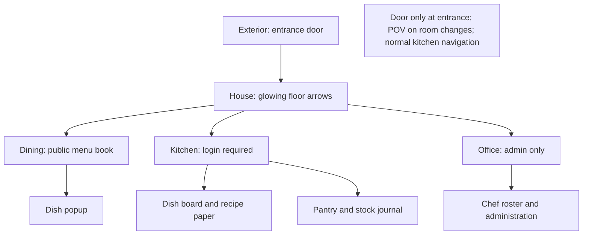
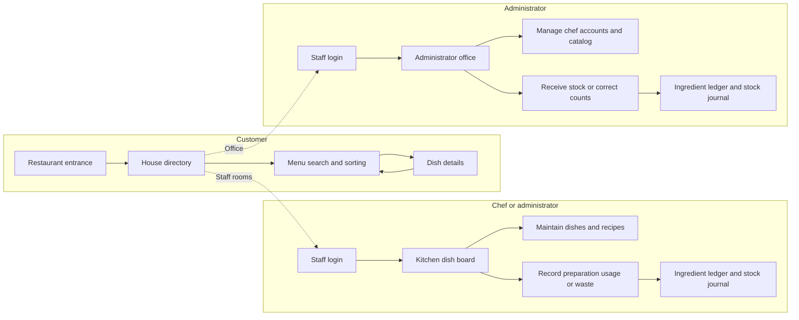
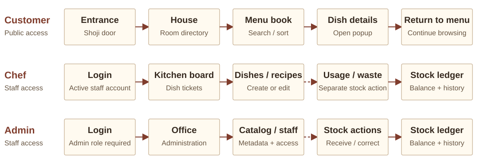
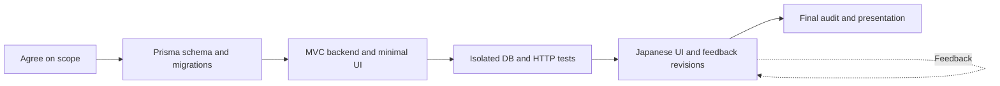
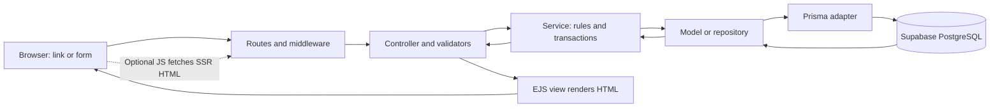
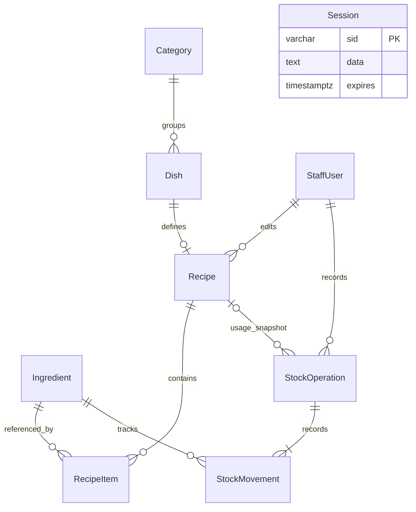
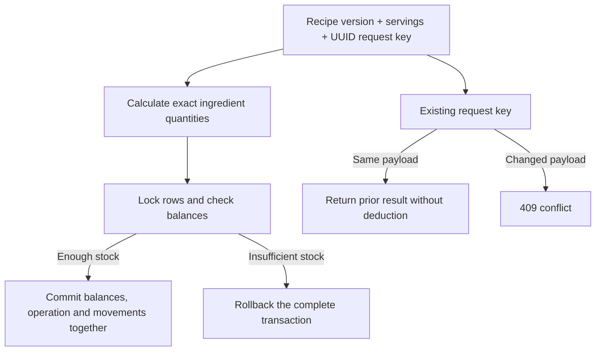

# 三太子亭 — Santaishi-tei

**Tam Thái Tử · Restaurant database exercise**  
Presentation material prepared 13 October 2026.

The HTML companion contains **16 main slides**, editable SVG diagrams, embedded screenshots, speaker notes and a reference appendix. It works offline as a single file. Open `presentation.html` in a browser; use arrow keys, Home/End, **N** for notes and **F** for fullscreen. Click a screenshot to enlarge it. The Print button includes the slides and appendix; these Markdown notes are the fuller rehearsal document.

Suggested timing: 10–12 minutes for the slides, then around 3 minutes for a prepared demo. Suggested division: presenter 1 covers slides 1–6 (website review), presenter 2 covers slides 7–11 (scope, architecture and database), presenter 3 covers slides 12–16 (HTTP, roles, inventory, verification and demo). Presenter assignments are optional and follow the website-first narrative.

Screenshots show the implemented UI with disposable sample records. Restaurant and food artwork are generated assets, not photographs of a real venue. Credentials are excluded. Local environment configuration is outside the presentation package.

## Main presentation

## Slide 01 — 三太子亭

Santaishi-tei is the restaurant identity chosen for the Tam Thái Tử group. This exercise combines a public restaurant introduction and menu with authenticated staff tools. JavaScript, SSR, MVC, Prisma and Supabase are the technical foundation.

**Speaker notes**

Santaishi-tei is the restaurant identity selected for the Tam Thái Tử group. The coursework combines a public restaurant introduction and menu with authenticated staff tools. Chefs maintain dishes and recipes and record ingredient use. Administrators manage the catalog, stock receipts, corrections and chef access. Development began with the database and backend, followed by the Japanese visual experience. The presentation reviews the completed website first, then explains the application workflow, development process, architecture, database and HTTP behavior. The final section presents verification evidence and a demonstration of the implemented workflow.

**Project evidence:** `README.md`, `public/images/japan/ASSETS.md`.

---

## Slide 02 — Entrance and house

The exterior uses a Japanese shoji door for the first entrance. The house offers dining to the left, kitchen to the right and office ahead. Glowing arrows sit on the floor; labels appear on hover/focus and remain visible on phones. Cross-room navigation uses short POV turns, while kitchen subpages use ordinary navigation.




**Speaker notes**

The exterior introduces the restaurant through a shoji entrance door. The house places dining to the left, the kitchen to the right and the administrator office ahead. Floor arrows integrate guidance into the setting. Labels appear on hover or keyboard focus and remain visible on phones. Protected destinations require staff authentication and the correct role. Room changes use a brief POV turn and step, approximately 210 milliseconds on exit and 240 on arrival. Kitchen subpages use ordinary navigation. Reduced-motion preferences skip movement. The architectural setting is generated artwork, while the screenshots show the implemented website.

**Project evidence:** `src/views/public/`, `public/js/`, `public/images/japan/ASSETS.md`.

---

## Slide 03 — Dining: the menu book

Customers browse a menu book against a dining-table background, with four dishes per spread. Search, categories and name/price sorting are server-backed. Two-sided 800 ms page turns have forward/backward direction, shading and shadows. Click details open a dish popup; regular SSR links remain usable.


**Speaker notes**

The public dining flow includes menu browsing, category and search filters, sorting, pagination and dish details. The backend renders each spread and applies public visibility rules. Draft and archived dishes do not appear in the public menu. A published dish can display its availability state. Browser JavaScript adds a two-sided page turn with forward/backward direction and moving shadows. The accepted turn duration is 800 milliseconds. Selecting a dish opens a dialog, with a normal details URL available as a fallback. Server-rendered pages remain accessible through standard navigation. Animation timing is demonstrated in the live application.

**Project evidence:** `src/controllers/public-controller.js`, `src/views/public/`, `public/js/`, `README.md`.

---

## Slide 04 — Kitchen: tickets and recipe paper

The kitchen presents dishes as clipped tickets with published, draft and availability states. Editing lifts a server-rendered sheet into a dialog. A confirmed save returns it to the board; validation failures preserve values. Recipe rows show per-serving quantities, pantry balances and Add/Remove controls. Fields lock while saving.


**Speaker notes**

The kitchen presents catalog dishes as clipped tickets. Chefs and administrators can create, edit or archive dishes, and maintain their per-serving recipes. Editing opens a server-rendered paper sheet. A confirmed save returns the sheet to the board, while validation errors preserve submitted values. Recipe forms contain ingredient quantities, preparation notes and Add/Remove controls. Existing recipe ingredients remain selected even when they fall outside the first 100 pantry results. Form fields lock while saving. This workspace maintains the dish catalog and preparation information. Stock changes require a separate usage or waste action, and the board does not process customer orders.

**Project evidence:** `src/controllers/kitchen-controller.js`, `src/views/kitchen/`, `public/js/`, `README.md`.

---

## Slide 05 — Pantry and administrator office

Ingredient jars, search, low-stock filtering and an alternate list view make pantry records easy to scan. Opening a label shows balance, recipe references and movement history. Administrators receive/correct stock and maintain metadata. The office provides chef creation, profile updates and access removal.


**Speaker notes**

The pantry combines visual jar labels with an alternate list view, search and low-stock filtering. An ingredient ledger displays the current balance, recipe references and the latest 30 movements. The stock journal displays the latest 100 operations. Chefs can record usage or waste, while administrators can also receive stock, correct counts and edit ingredient metadata. The office provides chef-account creation, profile updates and access removal. Access removal uses DELETE and deactivates the account while retaining historical references. Sample Administrator and Sample Chef are fictional screenshot records. Credentials and actual staff records are excluded from the presentation package.

**Project evidence:** `src/views/kitchen/`, `src/views/auth/`, `src/controllers/`, `README.md`.

---

## Slide 06 — Design decisions and feedback

The visual direction evolved through feedback: semi-3D trays became a menu book with click details; fast flips became two-sided 800 ms page turns; boxes and small signs became glowing floor arrows; repeated sliding doors became entrance-only doors plus POV room changes. The kitchen retained its accepted design. Komorebi was replaced by 三太子亭 — Santaishi-tei.

| Area | Earlier version | Final choice |
| --- | --- | --- |
| Dining | Semi-3D dish trays; hover details | Menu book on table; click popup; 800 ms leaf turn |
| House guidance | Three boxes, then hanging signs | Glowing arrows on the floor; hover/focus labels |
| Kitchen | Plain surface / simple forms | Japanese backdrop; ticket board; lifted recipe paper |
| Navigation | Repeated doors and guide text | Door at entrance; short POV turns between rooms |
| Pantry | Ingredient management unclear | Jars + list view, low-stock filters, ledger |

**Speaker notes**

The design evolved through approved feedback. The original semi-3D dish trays became a menu book on a dining-table background with click-based dish details. Kitchen tickets and paper editing gained a Japanese backdrop. Ingredient management became a pantry shelf with a list alternative and ledger. House guidance progressed from boxes to hanging signs, then to floor arrows. Repeated door effects were replaced with entrance-only sliding doors and short POV room transitions. The menu turn was slowed to 800 milliseconds, while the accepted kitchen design remained unchanged. The final restaurant identity, 三太子亭 — Santaishi-tei, represents Tam Thái Tử throughout the interface.

**Project evidence:** `docs/ui-revision.md`, `README.md`, `public/js/`.

---

## Slide 07 — Application workflow

Customers enter the restaurant, browse the menu, inspect a dish and return to browsing without an account. Chefs sign in to maintain dishes and recipes, view inventory, and record usage or waste. Administrators additionally manage chef access, categories and ingredient metadata, receive stock and correct counts.





The SVG provides a portable view of the workflow. The Mermaid source above retains its editable branching structure.

Recipe editing changes the per-serving specification. Usage, waste, receipts and corrections change stock balances and write movement history. Staff routes enforce authentication and role permissions on the server. Ordering, bookings and customer registration remain outside scope.

**Speaker notes**

Customers enter through the door, use the house directory, browse or filter the menu, inspect a dish and return to browsing. Customer registration, ordering and reservations are outside scope. Staff authenticate with an active account before entering protected tools. Chefs maintain dishes and per-serving recipes and record usage or waste through a separate stock action. Recipe saves do not deduct ingredients. Stock actions update balances and write immutable ledger entries together. Administrators additionally manage chef access, categories and ingredient metadata, receive stock and correct counts. Dashed arrows in the SVG identify separate tasks. The server enforces authentication and role permissions on each request.

**Project evidence:** `README.md`, `src/routes/index.js`, `src/middleware/security.js`, `src/services/stock-service.js`.

---

## Slide 08 — Development workflow

Scope → code-first Prisma schema → MVC backend with minimal UI → isolated database and HTTP verification → Japanese design and feedback revisions → final audit and presentation. Feedback looped through the UI phase while preserving the backend requirements.



**Speaker notes**

Development began with agreement on the public scope, roles and meaning of kitchen management. The code-first Prisma schema and versioned migrations defined the initial database. A minimal interface supported early checks of forms, permissions and transactions. Isolated database and HTTP tests preceded the detailed visual phase. The Japanese exterior, house, dining room, kitchen, pantry and office then developed through feedback. Revisions changed the menu, paper editing, guidance and motion while preserving the backend requirements. The final audit rechecked the original technical requirements and corrected bugs. This process connects product decisions, implementation and verification.

**Project evidence:** `README.md`, `docs/ui-revision.md`, `tests/`.

---

## Slide 09 — Backend decisions

The backend uses JavaScript. Express and EJS implement SSR. Prisma 7 with PrismaPg connects to Supabase PostgreSQL. Models and versioned migrations define the database before deployment. Static restaurant copy stays in EJS instead of restaurant_settings or content_sections tables. Credentials are private and ignored by Git.

**Speaker notes**

The selected requirements were JavaScript, Supabase, Prisma, code-first development, MVC and PRG. Express and EJS provide the HTTP server and server-rendered views. Prisma models describe the database, and versioned migrations create or update its PostgreSQL tables. The runtime database connection serves application queries, while a migration connection serves schema deployment. Credentials remain in local environment configuration. Static restaurant content belongs in templates because the project has no CMS editing requirement. Supabase hosts PostgreSQL, and the Express server controls application access. The Prisma backend does not require a Supabase API key.

**Project evidence:** `README.md`, `package.json`, `prisma/schema.prisma`.

---

## Slide 10 — MVC and server rendering

Browser → routes/security → controller/validators → service → model/repository → Prisma/PostgreSQL. The controller passes data to EJS, which returns HTML. Optional browser enhancement requests another server-rendered page and replaces the relevant fragment. Standard links and forms remain available.



**Speaker notes**

Routes identify each HTTP resource. Middleware restores sessions and checks authentication, roles and CSRF where required. Controllers coordinate input validation, service calls and responses. Services implement business rules and transactions. Models and repositories use Prisma to access PostgreSQL. Service results return to the controller, which renders EJS and sends HTML to the browser. Menu turns and recipe sheets request server-rendered HTML and animate the relevant fragment. The server remains responsible for content rendering, validation and permissions. Standard links and form submissions continue to work without browser JavaScript.

**Project evidence:** `src/app.js`, `src/routes/index.js`, `src/controllers/`, `src/services/`, `src/models/`, `src/views/`.

---

## Slide 11 — Database relations

Nine application models: StaffUser, Category, Dish, Ingredient, Recipe, RecipeItem, StockOperation, StockMovement and Session. Category groups dishes; a dish has at most one recipe; recipes reference ingredients through RecipeItem. Staff record operations, each operation has movements for ingredients. Sessions store server-side session data independently. Full field types are in the appendix.



**Speaker notes**

Categories and dishes form the public catalog. Each dish can have one recipe, and RecipeItem joins recipes to ingredients with a quantity per serving. Ingredient stores the current balance and low-stock threshold. StockOperation records the event header, and StockMovement records each ingredient balance before the event, its delta and the resulting balance. StaffUser identifies recipe editors and stock actors. Session stores the session payload and expiry without a staff foreign key. The schema contains nine application models plus Prisma migration metadata. Prices use integer VND and quantities use exact decimals. Catalog archives and staff deactivation preserve historical references.

**Project evidence:** `prisma/schema.prisma`, `prisma/migrations/`.

---

## Slide 12 — HTTP, PRG and DELETE

HTML forms send POST with hidden _method=DELETE and the session CSRF token. Middleware accepts only this POST body override, then executes the DELETE resource handler with CSRF and role checks. Success returns 303 and Location; browser follows GET. GET links never archive or deactivate. Validation 422, conflicts 409, forbidden 403, missing 404.

```mermaid
sequenceDiagram
  participant B as Browser
  participant E as Express
  participant D as Prisma / DB
  B->>E: POST /kitchen/dishes/:id + CSRF + _method=DELETE
  Note over E: Override to DELETE; check CSRF and role
  E->>D: Archive dish in transaction
  D-->>E: Success
  E-->>B: 303 See Other + Location: /kitchen/dishes
  B->>E: GET /kitchen/dishes
  E-->>B: Server-rendered HTML
  Note over B: Refresh repeats GET, not the mutation
```

```html
<!-- Example only: EJS inserts the real session-bound CSRF value. -->
<form method="post" action="/kitchen/dishes/DISH_ID">
  <input type="hidden" name="_csrf" value="SESSION_CSRF">
  <input type="hidden" name="_method" value="DELETE">
  <button type="submit">Archive dish</button>
</form>
```

The browser sends POST; method override selects the Express DELETE route. The resource remains archived for history. Success redirects with HTTP 303.

**Speaker notes**

Native HTML forms support GET and POST. Archive and deactivation forms submit POST with a hidden _method=DELETE field and a session-bound CSRF token. The server accepts DELETE overrides from the POST body only. Query-string, header and GET overrides cannot trigger deletion. The DELETE resource route still applies role and CSRF checks. After success, a 303 See Other response supplies a collection Location and the browser follows with GET. Refreshing the resulting page repeats GET. Validation failures return 422 with submitted values retained, and conflicts return 409. The sample CSRF value in this document is a placeholder.

**Project evidence:** `src/app.js`, `src/routes/index.js`, `src/middleware/security.js`, `src/views/`, `tests/`.

---

## Slide 13 — Role permissions

The role matrix defines access to each feature. Customers browse without an account. Chef and admin access is enforced in middleware and services, with active role/status reloaded on each request. Deactivating a chef takes effect on the next request.

| Action | Customer | Chef | Admin |
| --- | --- | --- | --- |
| Introduction, menu, dish details | Yes | Yes | Yes |
| Dishes | Published menu only | Create / edit / archive | Create / edit / archive |
| Recipes | — | View / edit | View / edit |
| Inventory and history | — | View | View |
| Record usage / waste | — | Yes | Yes |
| Receive stock / correct counts | — | — | Yes |
| Categories / ingredient metadata | — | — | Create / edit / archive |
| Chef accounts | — | — | Create / update / deactivate |

**Speaker notes**

Chefs and administrators maintain dishes and recipes, inspect inventory and record usage or waste. Administrators additionally manage categories, ingredient metadata and chef accounts, receive stock and correct counts. These restrictions also apply to direct HTTP requests. Passwords use Argon2 hashes. Login rotates the session ID, logout destroys it, and the database-backed cookie is HTTP-only with SameSite Lax and secure cookies in production. Mutations require CSRF tokens. The server reloads the active account and role on every authenticated request, so chef deactivation takes effect without waiting for the session to expire.

**Project evidence:** `README.md`, `src/middleware/security.js`, `src/services/auth-service.js`, `src/routes/index.js`.

---

## Slide 14 — Recipe and stock workflow

A recipe defines quantity per serving. Usage multiplies it by servings; 100 g rice × 2 deducts 200 g, reducing 2,500 g to 2,300 g. Editing a recipe changes no stock. Usage/waste create immutable movement history. Receipt adds stock; correction adds a signed compensating entry. Insufficient stock rolls back all ingredients.



**Speaker notes**

A recipe specifies quantities per serving. For example, two servings using 100 grams of rice each require 200 grams, reducing a 2,500-gram balance to 2,300 grams. The service snapshots the recipe version and calculates exact quantities with Decimal arithmetic. Deterministic locks and a Prisma transaction commit balances, operation headers and movement rows together. Insufficient stock for one ingredient rolls back the complete operation. UUID request keys prevent repeat deductions and reject reuse with changed data. Recipe versions detect stale edits. Corrections add compensating ledger entries, while tagged SQL supplies locking within Prisma transactions.

**Project evidence:** `src/services/recipe-service.js`, `src/services/stock-service.js`, `prisma/migrations/`.

---

## Slide 15 — Final verification and fixes

The recorded verification run passed 38 tests with zero failures. Schema validation and browser checks complemented the HTTP and database tests. Bugs fixed included archived-resource updates, signed corrections, form recovery, retained ingredient selections and pending form controls. Tests use isolated PGlite and Supertest, not live Supabase or production concurrency. Parent repository organization was corrected without recreating a nested repo.

**Speaker notes**

The recorded verification run passed 38 automated tests with zero failures. Coverage includes HTTP behavior, role restrictions, escaped output, CSRF, DELETE overrides, PRG, archive protection and recipe/stock rules. Tests use PGlite through PrismaPg and Supertest. The embedded fixture serializes transactions on one connection, so the result does not establish production load or cross-connection concurrency behavior. Browser checks used fictional sample records. Final fixes protected archived records, preserved failed form values and selected recipe ingredients, and locked pending paper forms. Repository organization also changed to an ordinary exercise folder under the parent Git checkout.

**Project evidence:** `README.md`, `tests/`, `docs/ui-revision.md`.

---

## Slide 16 — Live demonstration

Demo sequence: entrance → house → public menu filters/turn/details → prepared chef login → recipe edit → record usage → ledger → administrator tools → archive a disposable dish and inspect POST override/DELETE handler/303/GET. The demonstration uses a prepared sample environment. Saved screenshots provide an offline fallback. The presentation itself requires no database setup.

**Speaker notes**

The demonstration follows the public entrance and menu, then the chef recipe and stock workflow, and finally administrator permissions. A configured product application, prepared staff accounts and sample inventory support the demonstration. The chef edits a recipe and records a small usage operation, then opens the ledger. Administrator screens illustrate additional stock and account controls. A disposable demo dish demonstrates the archive request: browser POST, server DELETE override, HTTP 303 and the resulting GET. Saved screenshots provide an offline alternative. The final discussion covers SSR, role permissions and stock integrity.

**Project evidence:** `README.md`, `src/routes/index.js`, `tests/`.

---

## Appendix A — Team decision log

The decision log records project requirements and approved revisions in chronological order. Supporting implementation choices and their rationale appear separately.

| ID | Subject | Team decision | Result / reason |
| --- | --- | --- | --- |
| D01 | Restaurant introduction | Public landing page and menu; exclude ordering, reservations and customer accounts. | Keeps the exercise focused on information and staff management. |
| D02 | JavaScript | Use JavaScript instead of TypeScript. | Matches the exercise and avoids a separate type compilation step. |
| D03 | Supabase | Use managed PostgreSQL in Supabase. | Database hosting with a relational backend. |
| D04 | Code-first database | Start without tables; define models and migrations in code. | Schema becomes versioned, reviewable project material. |
| D05 | Prisma ORM | Use the recommended Node.js ORM connected to Supabase. | Prisma models and queries satisfy the ORM requirement. |
| D06 | MVC | Separate models, views and controllers in a dedicated exercise directory. | HTTP, data access and rendering have explicit responsibilities. |
| D07 | HTTP | Use HTTP methods and status codes deliberately. | GET reads; POST mutates; DELETE archives/deactivates resources. |
| D08 | PRG | Redirect successful form submissions with HTTP 303. | Refreshing the resulting page repeats GET. |
| D09 | Static restaurant copy | Keep introduction/settings/content sections in templates. | No CMS tables for fixed content. |
| D10 | Three roles | Public customers, authenticated chefs and admins. | Customer is a visitor role, not an account table. |
| D11 | Kitchen meaning | Maintain recipes and manually record ingredient usage or waste. | Kitchen board represents dishes, not live customer orders. |
| D12 | Credential privacy | Keep .env ignored and never inspect it after creation. | The owner supplies credentials privately. |
| D13 | Backend first | Implement backend with minimal test UI before the visual phase. | Verify persistence, roles and forms before animation work. |
| D14 | Japanese setting | Exterior sliding door; house with dining left, kitchen right, office ahead. | The rooms become navigation destinations. |
| D15 | Dining revision | Replace dish trays with a menu book on a dining-table background. | Four dishes per spread, search/sort/category filters and click details. |
| D16 | Kitchen revision | Use a Japanese kitchen image, ticket board and paper-like recipe editor. | Editing lifts a sheet; confirmed save returns it. |
| D17 | Ingredient experience | Accept pantry jars/list, low-stock search, ledgers and stock actions. | Ingredient data has a visual shelf and an auditable record. |
| D18 | House guidance revision | Replace boxes and then rejected small signs with glowing floor arrows. | Guidance belongs to the scene; labels work on focus and phones. |
| D19 | Motion revision | Use doors only on first entrance; POV room changes; normal same-room links. | Removes repeated door overlays and buggy guide text. |
| D20 | Menu turn timing | Slow the page flip and give it two faces, moving light and reverse direction. | Current turn lasts 800 ms instead of the earlier fast turn. |
| D21 | Kitchen preservation | Keep the accepted kitchen design during the final motion/house changes. | Later refinements stay within the requested scope. |
| D22 | Group identity | Rename Komorebi to 三太子亭 — Santaishi-tei for Tam Thái Tử. | Brand appears across titles, menus, tickets, pantry and footer. |
| D23 | Final backend audit | Recheck SSR, MVC, Prisma, PRG, permissions and DELETE override; fix bugs. | Final audit covers archived edits, recovery and method safety. |
| D24 | Repository organization | Keep the exercise inside the existing Webapp Developing Git checkout. | Nested Git metadata was backed up; the exercise uses parent history. |
| D25 | Presentation materials | Create HTML and Markdown with diagrams, screenshots, decisions and notes. | Offline presentation plus detailed rehearsal/reference document. |
| D26 | Presentation order | Review the completed website before discussing the backend and other technical details. | Entrance, dining, kitchen, pantry/office and design feedback follow the cover; backend slides follow them. |
| D27 | Workflow and documentation audience | Include the application workflow diagram and rewrite both READMEs for users and the lecturer. | Slide 7 shows role-based application paths. Documentation describes product use, setup and assessment for users and the lecturer. |

### Supporting implementation choices

| Choice | Implementation rationale |
| --- | --- |
| Express 5 + EJS | JavaScript HTTP server and server-rendered views fit the requested SSR/MVC approach. |
| Private restaurant schema | Server owns database access; Supabase anon/authenticated roles cannot access these tables. |
| Nine application models | Catalog, staff, recipes, stock history and sessions; no customer/order/booking models. |
| BIGINT and NUMERIC(14,3) | Integer VND prices and Decimal quantities avoid floating-point balance errors. |
| Transactions and locks | Balances, operation headers and movement rows commit together; tagged SQL supplies row/advisory locks. |
| Version + request key | Recipe versions detect stale edits; stock request keys prevent duplicate deductions. |
| Archive and deactivation | Catalog archives and inactive staff preserve historical foreign keys. |
| Session security | Argon2 password hashes, DB-backed sessions, rotated login IDs, CSRF and per-request role reload. |
| SSR enhancement | Browser JS requests server-rendered HTML fragments for paper/menu effects; standard links/forms remain. |
| Local artwork | Generated backgrounds and dish art, optimized JPGs; PNG masters/prompts retained. |
| Isolated verification | PGlite through PrismaPg and Supertest, plus browser checks using fictional sample records. |
| Current boundaries | Local image paths, capped staff lists, no uploads, reset email, suppliers, expiry batches or multiple locations. |

## Appendix B — Full database field reference

All scalar fields from `prisma/schema.prisma` are included below. Table names are in the private `restaurant` schema. Relation objects and arrays are virtual Prisma fields, not SQL columns. A `?` marks nullable Prisma fields. `uuid()` is a Prisma client-generated default; `@updatedAt` is maintained by Prisma. Foreign keys use restricted deletion. The model list excludes `_prisma_migrations`, which is migration tooling metadata.

### StaffUser — `restaurant.staff_users`

| Prisma field | SQL column | Prisma type | SQL type | Nullable | Defaults / keys |
| --- | --- | --- | --- | --- | --- |
| id | id | String | UUID | No | PK; default uuid() |
| email | email | String | VARCHAR(254) | No | UNIQUE |
| passwordHash | password_hash | String | TEXT | No | — |
| displayName | display_name | String | VARCHAR(100) | No | — |
| role | role | String | VARCHAR(10) | No | — |
| isActive | is_active | Boolean | BOOLEAN | No | default true |
| lastLoginAt | last_login_at | DateTime? | TIMESTAMPTZ | Yes | — |
| createdAt | created_at | DateTime | TIMESTAMPTZ | No | default now() |
| updatedAt | updated_at | DateTime | TIMESTAMPTZ | No | default now(); Prisma updates timestamp |

Primary and unique keys are shown above.

### Category — `restaurant.categories`

| Prisma field | SQL column | Prisma type | SQL type | Nullable | Defaults / keys |
| --- | --- | --- | --- | --- | --- |
| id | id | String | UUID | No | PK; default uuid() |
| name | name | String | VARCHAR(100) | No | — |
| slug | slug | String | VARCHAR(120) | No | UNIQUE |
| description | description | String? | TEXT | Yes | — |
| displayOrder | display_order | Int | INTEGER | No | default 0 |
| isActive | is_active | Boolean | BOOLEAN | No | default true |
| archivedAt | archived_at | DateTime? | TIMESTAMPTZ | Yes | — |
| createdAt | created_at | DateTime | TIMESTAMPTZ | No | default now() |
| updatedAt | updated_at | DateTime | TIMESTAMPTZ | No | default now(); Prisma updates timestamp |

Primary and unique keys are shown above.

### Dish — `restaurant.dishes`

| Prisma field | SQL column | Prisma type | SQL type | Nullable | Defaults / keys |
| --- | --- | --- | --- | --- | --- |
| id | id | String | UUID | No | PK; default uuid() |
| categoryId | category_id | String | UUID | No | FK |
| name | name | String | VARCHAR(150) | No | — |
| slug | slug | String | VARCHAR(180) | No | UNIQUE |
| description | description | String? | TEXT | Yes | — |
| priceMinor | price_minor | BigInt | BIGINT | No | — |
| currency | currency | String | VARCHAR(3) | No | default "VND" |
| imagePath | image_path | String? | TEXT | Yes | — |
| imageAlt | image_alt | String? | VARCHAR(200) | Yes | — |
| isFeatured | is_featured | Boolean | BOOLEAN | No | default false |
| isPublished | is_published | Boolean | BOOLEAN | No | default false |
| isAvailable | is_available | Boolean | BOOLEAN | No | default true |
| displayOrder | display_order | Int | INTEGER | No | default 0 |
| archivedAt | archived_at | DateTime? | TIMESTAMPTZ | Yes | — |
| createdAt | created_at | DateTime | TIMESTAMPTZ | No | default now() |
| updatedAt | updated_at | DateTime | TIMESTAMPTZ | No | default now(); Prisma updates timestamp |

Additional constraints: `@@index([categoryId, isPublished])`.

### Ingredient — `restaurant.ingredients`

| Prisma field | SQL column | Prisma type | SQL type | Nullable | Defaults / keys |
| --- | --- | --- | --- | --- | --- |
| id | id | String | UUID | No | PK; default uuid() |
| name | name | String | VARCHAR(150) | No | UNIQUE |
| description | description | String? | TEXT | Yes | — |
| baseUnit | base_unit | String | VARCHAR(10) | No | — |
| quantityOnHand | quantity_on_hand | Decimal | NUMERIC(14,3) | No | default 0 |
| lowStockThreshold | low_stock_threshold | Decimal | NUMERIC(14,3) | No | default 0 |
| isActive | is_active | Boolean | BOOLEAN | No | default true |
| archivedAt | archived_at | DateTime? | TIMESTAMPTZ | Yes | — |
| createdAt | created_at | DateTime | TIMESTAMPTZ | No | default now() |
| updatedAt | updated_at | DateTime | TIMESTAMPTZ | No | default now(); Prisma updates timestamp |

Primary and unique keys are shown above.

### Recipe — `restaurant.recipes`

| Prisma field | SQL column | Prisma type | SQL type | Nullable | Defaults / keys |
| --- | --- | --- | --- | --- | --- |
| id | id | String | UUID | No | PK; default uuid() |
| dishId | dish_id | String | UUID | No | UNIQUE; FK |
| instructions | instructions | String | TEXT | No | default "" |
| preparationMinutes | preparation_minutes | Int? | INTEGER | Yes | — |
| cookingMinutes | cooking_minutes | Int? | INTEGER | Yes | — |
| version | version | Int | INTEGER | No | default 1 |
| updatedBy | updated_by | String | UUID | No | FK |
| createdAt | created_at | DateTime | TIMESTAMPTZ | No | default now() |
| updatedAt | updated_at | DateTime | TIMESTAMPTZ | No | default now(); Prisma updates timestamp |

Primary and unique keys are shown above.

### RecipeItem — `restaurant.recipe_items`

| Prisma field | SQL column | Prisma type | SQL type | Nullable | Defaults / keys |
| --- | --- | --- | --- | --- | --- |
| recipeId | recipe_id | String | UUID | No | FK |
| ingredientId | ingredient_id | String | UUID | No | FK |
| quantity | quantity | Decimal | NUMERIC(14,3) | No | — |
| notes | notes | String? | VARCHAR(250) | Yes | — |
| createdAt | created_at | DateTime | TIMESTAMPTZ | No | default now() |
| updatedAt | updated_at | DateTime | TIMESTAMPTZ | No | default now(); Prisma updates timestamp |

Additional constraints: `@@id([recipeId, ingredientId]) @@index([ingredientId])`.

### StockOperation — `restaurant.stock_operations`

| Prisma field | SQL column | Prisma type | SQL type | Nullable | Defaults / keys |
| --- | --- | --- | --- | --- | --- |
| id | id | String | UUID | No | PK; default uuid() |
| type | type | String | VARCHAR(12) | No | — |
| reason | reason | String | TEXT | No | — |
| recipeId | recipe_id | String? | UUID | Yes | FK |
| recipeVersion | recipe_version | Int? | INTEGER | Yes | — |
| servings | servings | Int? | INTEGER | Yes | — |
| createdBy | created_by | String | UUID | No | FK |
| requestKey | request_key | String | UUID | No | UNIQUE |
| createdAt | created_at | DateTime | TIMESTAMPTZ | No | default now() |

Additional constraints: `@@index([createdAt])`.

### StockMovement — `restaurant.stock_movements`

| Prisma field | SQL column | Prisma type | SQL type | Nullable | Defaults / keys |
| --- | --- | --- | --- | --- | --- |
| id | id | String | UUID | No | PK; default uuid() |
| operationId | operation_id | String | UUID | No | FK |
| ingredientId | ingredient_id | String | UUID | No | FK |
| quantityDelta | quantity_delta | Decimal | NUMERIC(14,3) | No | — |
| quantityBefore | quantity_before | Decimal | NUMERIC(14,3) | No | — |
| quantityAfter | quantity_after | Decimal | NUMERIC(14,3) | No | — |
| createdAt | created_at | DateTime | TIMESTAMPTZ | No | default now() |

Additional constraints: `@@unique([operationId, ingredientId]) @@index([ingredientId, createdAt])`.

### Session — `restaurant.sessions`

| Prisma field | SQL column | Prisma type | SQL type | Nullable | Defaults / keys |
| --- | --- | --- | --- | --- | --- |
| sid | sid | String | VARCHAR(36) | No | PK |
| data | data | String | TEXT | No | — |
| expires | expires | DateTime | TIMESTAMPTZ | No | — |
| createdAt | created_at | DateTime | TIMESTAMPTZ | No | default now() |
| updatedAt | updated_at | DateTime | TIMESTAMPTZ | No | default now(); Prisma updates timestamp |

Additional constraints: `@@index([expires])`.

### Additional database integrity

- `recipe_items` has a composite primary key: `(recipe_id, ingredient_id)`.
- CHECK constraints enforce valid roles and units, nonnegative ingredient balances, positive recipe quantities, complete recipe-usage references, and valid movement signs/math.
- Triggers preserve immutable stock history and prevent changing a referenced ingredient’s unit.
- Archived catalog records and inactive staff retain history and foreign-key references.
- Money is integer VND in `BIGINT`. Quantities use exact `NUMERIC(14,3)` and Decimal calculations.
- Recipe versions reject stale edits. Operation request keys prevent repeat deductions and reject reuse with a changed payload.
- Prisma transactions commit ingredient balances, operation headers and movement history together. Tagged SQL inside those transactions supplies deterministic row/advisory locks.
- The server-only schema denies access to Supabase `anon` and `authenticated` roles. Express authorization and restricted database credentials are the access boundary; Supabase client RLS is not the application’s authorization mechanism.

## Appendix C — HTTP endpoint reference

| Method | Path | Access | Behavior |
| --- | --- | --- | --- |
| GET | / ; /directory ; /menu ; /menu/:slug | Public | Introduction, room directory, filtered menu, dish details |
| GET / POST | /login | Public | Login form / authenticate (rate limited) |
| POST | /logout | Chef / admin | Destroy session → 303 |
| GET | /admin | Admin | Office overview |
| GET / POST | /admin/staff | Admin | List / create chef |
| POST | /admin/staff/:id/update | Admin | Update chef profile / access |
| DELETE | /admin/staff/:id | Admin | Deactivate chef → 303 |
| GET | /admin/dishes | Admin | Legacy link → 303 /kitchen/dishes |
| GET | /kitchen | Chef / admin | Kitchen board |
| GET / POST | /kitchen/dishes/:id/recipe | Chef / admin | Recipe form / save versioned recipe |
| POST | /kitchen/dishes/:id/usage | Chef / admin | Deduct recipe quantities × servings |
| GET | /kitchen/ingredients/:id | Chef / admin | Balance, recipe references, latest 30 movements |
| GET | /kitchen/stock-history | Chef / admin | Latest 100 stock operations |
| GET | /kitchen/stock/new | Chef / admin | Role-aware stock operation form |
| POST | /kitchen/stock/receipts ; /kitchen/stock/corrections | Admin | Receive stock / signed compensating correction |
| POST | /kitchen/stock/usage ; /kitchen/stock/waste | Chef / admin | Manual ingredient deductions |
| GET / POST | /setup | Development + loopback; before first admin | Initial admin bootstrap; unavailable after setup |

### Catalog pattern

`BASE` is `/admin/categories`, `/kitchen/dishes`, or `/kitchen/ingredients`. Write access is administrator-only for categories and ingredient metadata, and chef/administrator for dishes.

| Method | Path | Access | Behavior |
| --- | --- | --- | --- |
| GET | BASE | Admin for categories; chef/admin for dishes and ingredient lists | Read collection |
| GET | BASE/new ; BASE/:id/edit | Write access | Render form |
| POST | BASE ; BASE/:id/update | Write access | Create / update → 303 |
| DELETE | BASE/:id | Write access | Archive → 303 |

### HTTP responses and mutation rules

- Successful form mutation: **303 See Other** with `Location`, followed by browser GET.
- Validation failure: **422** with input retained.
- Stale recipe or changed payload using an existing request key: **409**.
- Forbidden operation: **403**; missing resource: **404**.
- Unauthenticated mutation: **401**; protected page GET redirects to login.
- DELETE resource forms submit POST with hidden `_method=DELETE`; only this POST body override is accepted. GET, query-string and header overrides cannot trigger deletion.
- All mutations require session-bound CSRF. Archive/deactivation preserves history.
- Setup is a development-only, loopback-only bootstrap and closes once the first administrator exists. No staff credentials are seeded.

## Appendix D — Screenshot gallery and provenance

The main slides show entrance, house, menu, kitchen, recipe, pantry and office. The following screenshots support detailed questions:

### Dish detail popup


### Ingredient ledger after sample usage


### Immutable stock-operation journal


Entrance and house screenshots reuse the final branded UI previews. Other screenshots were captured from the implemented server-rendered UI using an isolated disposable database. `Sample Administrator`, `Sample Chef` and `.test` email addresses are fictional. Stock receipts, usage and waste in the screenshots are sample events. No live Supabase data or real staff credentials were used.

Generated background and dish artwork is documented in `public/images/japan/ASSETS.md`. Local JPG backgrounds total about 1.75 MB, compared with about 9.09 MB for the PNG masters, a reduction of approximately 80.7%; masters and prompts are retained. Screenshots document the static appearance. The live application demonstrates page turns and room motion.

The HTML embeds its images and has no CDN, external font or network dependency. Keep `presentation-assets/` alongside this Markdown document when moving it. Project source references identify paths in the original repository and remain readable after this folder moves. Mermaid diagrams require a Markdown viewer with Mermaid support. The HTML displays its SVG diagrams directly without an add-on.

## Appendix E — Demo checklist

Before the presentation:

1. Open the HTML locally and test slide selection, arrow keys, notes, enlarged screenshots and fullscreen.
2. Start the already configured app from `restaurant-mvc` with `npm start`. Do not run migrations or reseed solely for the presentation.
3. Prepare a demo chef and administrator account. Keep passwords and `.env` off screen.
4. Use disposable demo dishes and enough demo inventory. Rehearse small, reversible edits; do not archive real records just for the talk.
5. Have browser developer tools ready to inspect method/status behavior.
6. Keep screenshots available if network, authentication or app startup fails.

| Step | Action | What to explain |
| --- | --- | --- |
| 1 | Enter exterior → house | Door at entrance; arrows indicate rooms |
| 2 | Open public menu, filter, sort, turn, select dish | SSR content plus browser enhancement |
| 3 | Sign in as prepared chef, edit recipe | Per-serving quantities; optimistic version; save returns sheet |
| 4 | Record two servings of usage on demo stock | Exact deduction, transaction, request key |
| 5 | Open ingredient ledger and journal | Immutable audit history and current balance |
| 6 | Show admin stock and chef controls | Role differences enforced on the server |
| 7 | Archive a disposable dish, inspect network | Browser POST → DELETE handler → 303 → GET |

Offline fallback: saved screenshots document the interface. Animation and HTTP behavior require the running application or the recorded verification evidence.

## Appendix F — Questions and answers

| Question | Answer |
| --- | --- |
| Does animation break SSR? | No. EJS creates the page and forms on the server. Browser enhancement fetches SSR HTML and animates it; ordinary navigation remains available. |
| Why no customer table? | Customer is an anonymous visitor role. Ordering, booking and customer sign-up were excluded. |
| Why static content outside the DB? | The introduction is fixed content, with no requested CMS editing workflow. EJS templates are sufficient. |
| Does saving a recipe deduct stock? | No. A recipe describes quantities per serving. Recording preparation usage or waste changes balances. |
| Is DELETE really used? | HTML POST plus body _method=DELETE invokes an Express DELETE resource route. GET/query/header overrides are rejected or ignored. |
| Why archive instead of physical delete? | Catalog history and foreign keys must remain valid. Chef removal sets inactive; stock history remains immutable. |
| Does PRG prevent every duplicate operation? | It avoids resubmission on refresh after success. Stock UUID request keys additionally prevent duplicate deductions. |
| Are the 38 tests production concurrency proof? | No. Embedded PGlite uses serialized transactions. Production uses row/advisory locks; cross-connection load tests are separate work. |
| Are the photos a real restaurant? | No. The background and food artwork are generated assets. Screenshots are the implemented UI with disposable sample records. |
| Where are the tables in Supabase? | Application tables are in the private restaurant schema, after migration deployment. Select that schema in the dashboard. |

## Appendix G — Verification evidence and current limits

Recorded verification result (13 October 2026): `npm test` completed with **38 passed, 0 failed**. These tests use isolated PGlite through the Prisma PostgreSQL adapter and Supertest. The fixture serializes transactions on one embedded connection, so it is not a production load or cross-connection concurrency test. No `.env` is loaded and Supabase is not modified by those tests.

Schema validation used an isolated audit configuration. Browser checks exercised paper saves, failed usage recovery, signed corrections, duplicate chef form recovery and DELETE confirmation with a disposable browser fixture. Fixes included blocked archived-resource updates, retained invalid form values, saved ingredients beyond the first 100 pantry results, Add/Remove state and locked fields during pending paper saves.

Most staff lists currently cap at 100 records. The ingredient ledger shows the latest 30 movements and the stock journal the latest 100 operations; public menu pagination covers published dishes. Uploaded media, password-reset email, supplier management, expiry batches, multiple locations and production load testing remain outside the exercise.

The Git issue was organizational: an embedded checkout in the exercise folder interfered with the intended parent-repository setup. Its metadata was backed up; `restaurant-mvc` now lives as an ordinary folder in the existing Webapp Developing repository.

## Appendix H — Project source reference

Project paths identify evidence in the original source checkout. They are reference identifiers, not dependencies of this package. The complete source code remains in the product repository.

| Evidence | Original project path |
| --- | --- |
| Project overview | `restaurant-mvc/README.md` |
| Project rules | `restaurant-mvc/AGENTS.md` |
| Schema | `restaurant-mvc/prisma/schema.prisma` |
| Versioned migrations | `restaurant-mvc/prisma/migrations/` |
| HTTP routes | `restaurant-mvc/src/routes/index.js` |
| Application / SSR setup | `restaurant-mvc/src/app.js` |
| Security middleware | `restaurant-mvc/src/middleware/security.js` |
| Model / repository layer | `restaurant-mvc/src/models/` |
| Controllers | `restaurant-mvc/src/controllers/` |
| Services | `restaurant-mvc/src/services/` |
| Prisma configuration and adapter | `restaurant-mvc/src/config/` |
| EJS views | `restaurant-mvc/src/views/` |
| UI revisions | `restaurant-mvc/docs/ui-revision.md` |
| Artwork provenance and prompts | `restaurant-mvc/public/images/japan/ASSETS.md` |
| Automated checks and fixtures | `restaurant-mvc/tests/` |
| Browser enhancements | `restaurant-mvc/public/js/` |
