# 三太子亭 — Santaishi-tei

**Tam Thái Tử · Restaurant database exercise**  
Presentation material prepared 13 October 2026.

The HTML companion contains **16 main slides**, editable SVG diagrams, embedded screenshots, speaker notes and a reference appendix. It works offline as a single file. Open `presentation.html` in a browser; use arrow keys, Home/End, **N** for notes and **F** for fullscreen. Click a screenshot to enlarge it. The Print button includes the slides and appendix; these Markdown notes are the fuller rehearsal document.

Suggested timing: 10–12 minutes for the slides, then around 3 minutes for a prepared demo. Suggested division: presenter 1 covers slides 1–6 (website review), presenter 2 covers slides 7–11 (scope, architecture and database), presenter 3 covers slides 12–16 (HTTP, roles, inventory, verification and demo). Adjust to your team; no individual assignments are assumed.

Screenshots show the implemented UI with disposable sample records. Restaurant and food artwork are generated assets, not photographs of a real venue. Credentials are excluded. The actual `.env` was not read or copied.

## Main presentation

## Slide 01 — 三太子亭

Santaishi-tei is the restaurant identity chosen for the Tam Thái Tử group. This exercise combines a public restaurant introduction and menu with authenticated staff tools. JavaScript, SSR, MVC, Prisma and Supabase are the technical foundation.

**Speaker notes**

Introduce the group and pronounce the chosen name, Santaishi-tei. Explain that this is a database exercise presented through a Japanese restaurant setting. The public experience introduces the restaurant and lets people browse dishes. Behind it, chefs maintain recipes and record ingredient use, while administrators manage the catalog, stock and chef access. The architecture was built first and the visual experience was refined afterward. Suggested timing is 10–12 minutes for the slides and about 3 minutes for a prepared live demonstration. The presentation reviews the completed website first, then explains scope, architecture, database, HTTP, roles and inventory. Suggested presenter responsibilities follow that order; these are not named team assignments.

**Project evidence:** `README.md`, `public/images/japan/ASSETS.md`.

---

## Slide 02 — Entrance and house

The exterior uses a Japanese shoji door for the first entrance. The house offers dining to the left, kitchen to the right and office ahead. Glowing arrows sit on the floor; labels appear on hover/focus and remain visible on phones. Cross-room navigation uses short POV turns, while kitchen subpages use ordinary navigation.

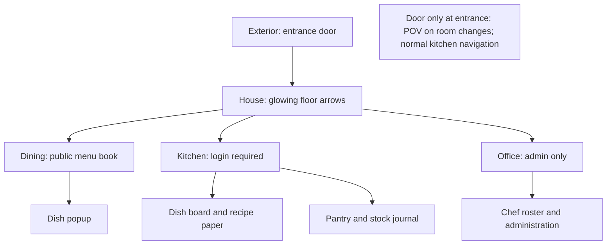

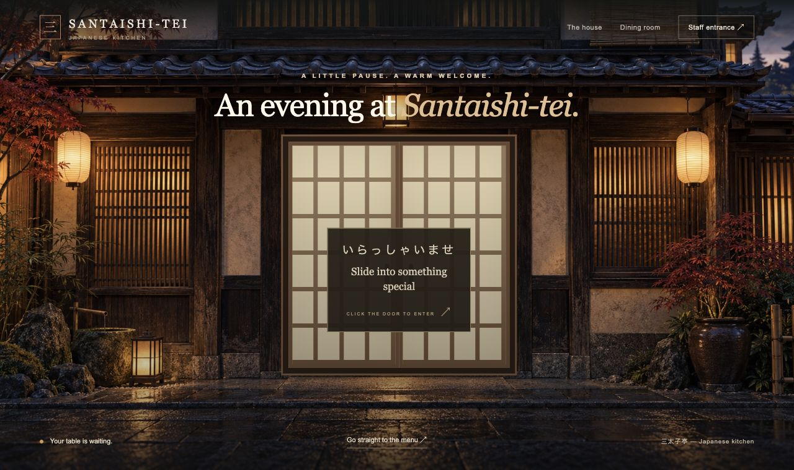

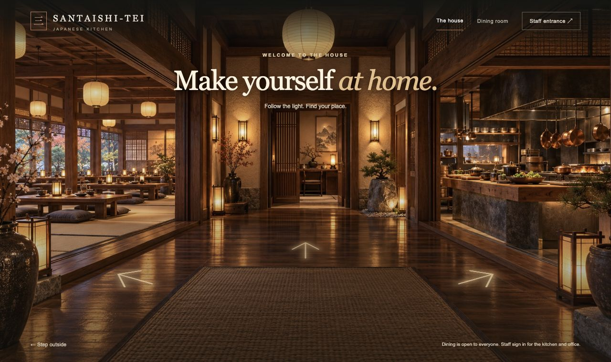

**Speaker notes**

Show the architectural background and explain the spatial navigation. The initial entrance feels like stepping into the restaurant because the native door panels slide open. Inside the house, arrows guide visitors toward the three destinations without placing unrelated boxes over the room. Keyboard focus reveals labels as hover does; phones show them continuously. Kitchen and office links lead to authentication when required. Cross-room travel uses a short turn and step animation, with about 210 milliseconds on exit and 240 on arrival. It is deliberately brief to keep navigation responsive. Motion is skipped for reduced-motion preferences. The screenshots show the implemented interface; the restaurant setting is generated artwork, not a photograph of a real venue.

**Project evidence:** `src/views/public/`, `public/js/`, `public/images/japan/ASSETS.md`.

---

## Slide 03 — Dining: the menu book

Customers browse a menu book against a dining-table background, with four dishes per spread. Search, categories and name/price sorting are server-backed. Two-sided 800 ms page turns have forward/backward direction, shading and shadows. Click details open a dish popup; regular SSR links remain usable.

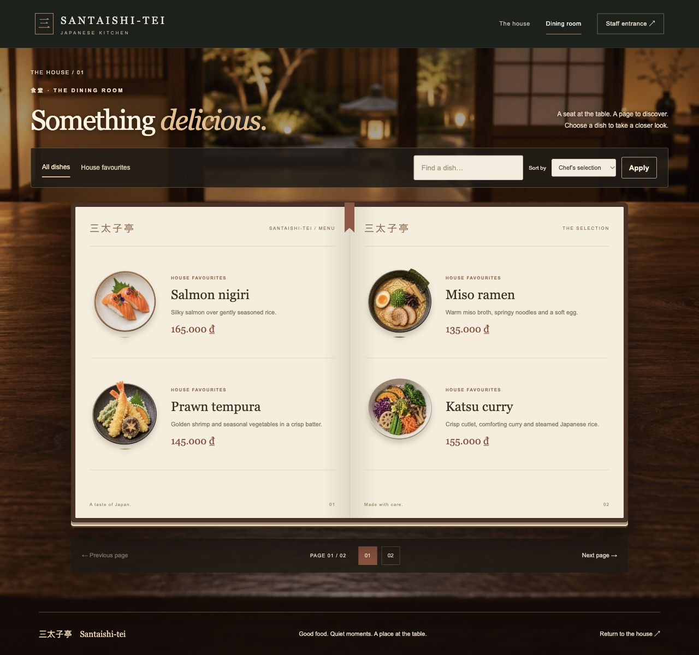

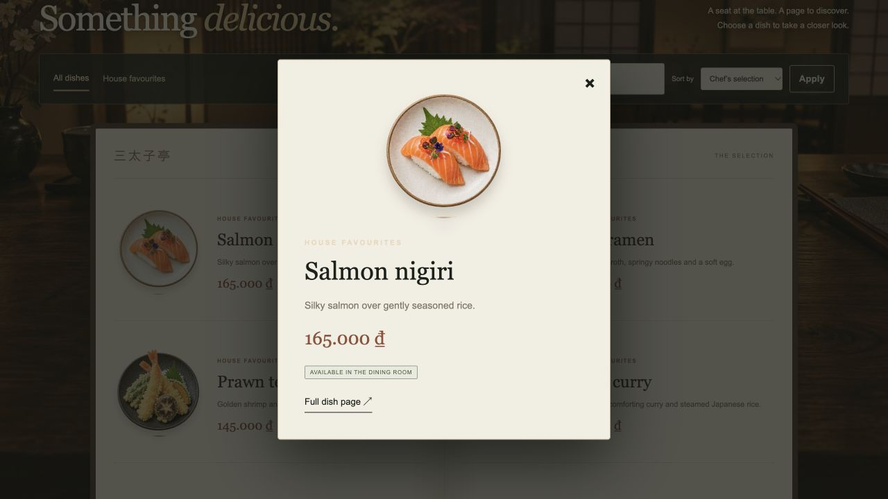

**Speaker notes**

Describe the dining flow: enter, open the menu, filter or sort, turn a page, then select a dish. The backend renders the spread and applies the public visibility rules. Draft and archived dishes are excluded; availability can still be shown for published dishes. JavaScript animates server-rendered content instead of building an independent client database. The turn was slowed after feedback because the earlier version felt too fast to resemble a physical page. It now has a front and back face, directional reversal and moving shadows. Rapid clicks are cleaned up rather than stacking animation state. Opening a dish uses a popup for convenience, with a normal details URL as fallback. Use the live demo to show motion; a still image cannot prove animation timing.

**Project evidence:** `src/controllers/public-controller.js`, `src/views/public/`, `public/js/`, `README.md`.

---

## Slide 04 — Kitchen: tickets and recipe paper

The kitchen presents dishes as clipped tickets with published, draft and availability states. Editing lifts a server-rendered sheet into a dialog. A confirmed save returns it to the board; validation failures preserve values. Recipe rows show per-serving quantities, pantry balances and Add/Remove controls. Fields lock while saving.

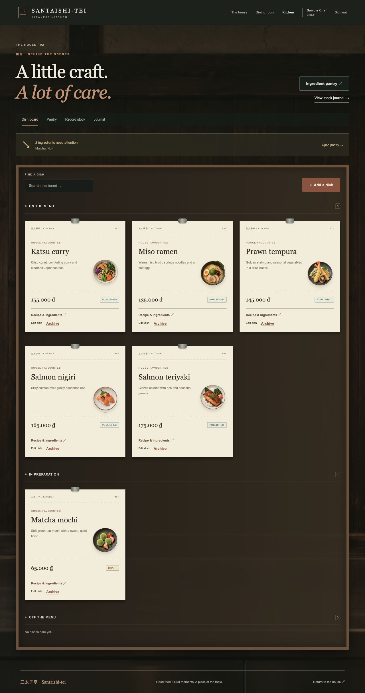

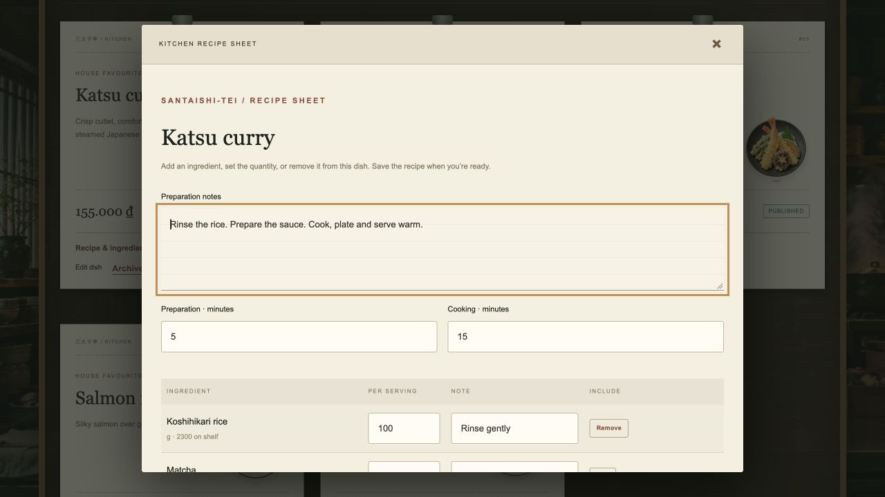

**Speaker notes**

A chef sees dish tickets and can edit a dish or recipe sheet, create another dish, or archive a dish with confirmation. The visual metaphor is paper taken off a board and written on, while the form and authorization still belong to the server. A sheet returns only after a successful save; failed validation keeps the entered values visible. Recipe editing includes ingredient quantities per serving, preparation notes and Add/Remove controls. The final audit ensured existing ingredients beyond the first 100 pantry results remain available and fields cannot be changed while a save is pending. This is a catalog and preparation workspace, so the board does not process customer orders. Stock is deducted only when usage is recorded, not when the recipe is edited.

**Project evidence:** `src/controllers/kitchen-controller.js`, `src/views/kitchen/`, `public/js/`, `README.md`.

---

## Slide 05 — Pantry and administrator office

Ingredient jars, search, low-stock filtering and an alternate list view make pantry records easy to scan. Opening a label shows balance, recipe references and movement history. Administrators receive/correct stock and maintain metadata. The office provides chef creation, profile updates and access removal.

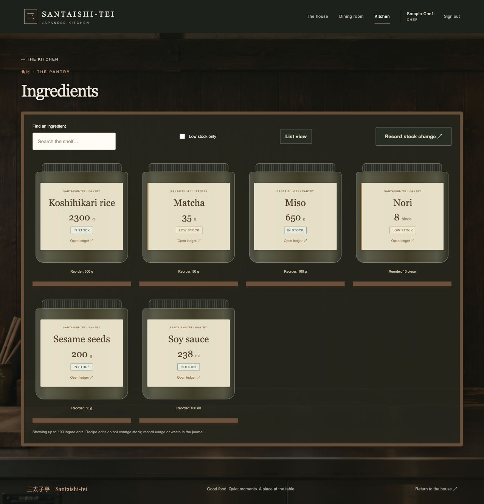

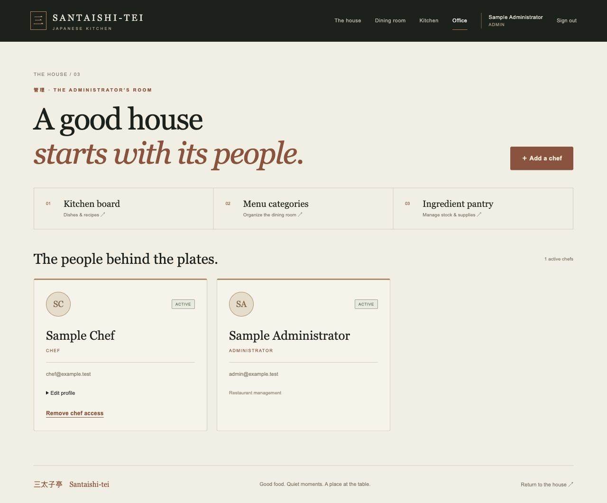

**Speaker notes**

The pantry addresses the team’s question about how ingredient management should feel in the restaurant. Jar labels make names, units and low balances visible, while a list view supports more practical scanning. A ledger opens from the ingredient and shows current stock, recipes that use it and the latest 30 movements. The journal shows the latest 100 operations. Chefs record usage or waste; administrators receive ingredients or correct counts with a reason. In the office, the administrator creates and updates chef accounts. Access removal uses DELETE and deactivation so historical editors and stock actors remain traceable. The screenshots use fictional Sample Administrator and Sample Chef records, not actual staff accounts or credentials.

**Project evidence:** `src/views/kitchen/`, `src/views/auth/`, `src/controllers/`, `README.md`.

---

## Slide 06 — Design decisions and feedback

The visual direction evolved through feedback: semi-3D trays became a menu book with click details; fast flips became two-sided 800 ms page turns; boxes and small signs became glowing floor arrows; repeated sliding doors became entrance-only doors plus POV room changes. The kitchen retained its accepted design. Komorebi was replaced by 三太子亭 — Santaishi-tei.

| Area | Earlier version | Final choice |
| --- | --- | --- |
| Dining | Semi-3D dish trays; hover details | Menu book on table; click popup; 800 ms leaf turn |
| House guidance | Three boxes, then hanging signs | Glowing arrows on the floor; hover/focus labels |
| Kitchen | Plain surface / simple forms | Japanese backdrop; ticket board; lifted recipe paper |
| Navigation | Repeated doors and guide text | Door at entrance; short POV turns between rooms |
| Pantry | Ingredient management unclear | Jars + list view, low-stock filters, ledger |

**Speaker notes**

This slide shows the decisions rather than suggesting the first proposal was the final design. Customers initially viewed dishes on semi-3D trays with hover information. Feedback preferred a menu on a dining table and dish popups triggered by a click. The kitchen gained a generated backdrop, clipped dish tickets and a paper editor. Ingredient management became a pantry shelf with a list alternative and ledger. House guidance moved through boxes and small signs before the team accepted arrows projected onto the floor. Repeated door effects and buggy text were removed from room switches. Later feedback slowed the menu turn to 800 milliseconds and preserved the kitchen. The final name reflects Tam Thái Tử and appears consistently across the UI.

**Project evidence:** `docs/ui-revision.md`, `README.md`, `public/js/`.

---

## Slide 07 — The exercise scope

Customers browse anonymously. Chefs maintain dishes and recipes, see inventory, and record usage/waste. Administrators also manage categories, ingredient metadata, receipts, corrections and chef accounts. Ordering, bookings and customer account features were explicitly removed from scope.

**Speaker notes**

The first important decision was narrowing the product. A broad restaurant management proposal initially suggested customer accounts and ordering or booking, but the team clarified that the public website should introduce the restaurant. Customer therefore means an anonymous visitor, not a registered user. Only chefs and administrators sign in. Kitchen management was clarified as maintaining recipes and manually recording usage or waste. An order-board visual style remains useful for displaying dish tickets, but there is no customer order workflow behind it. This scope decision explains why the schema has recipes and stock movements without users, orders, reservations or restaurant CMS sections.

**Project evidence:** `AGENTS.md`, `README.md`.

---

## Slide 08 — Development workflow

Scope → code-first Prisma schema → MVC backend with minimal UI → isolated database and HTTP verification → Japanese design and feedback revisions → final audit and presentation. Feedback looped through the UI phase while preserving the backend requirements.

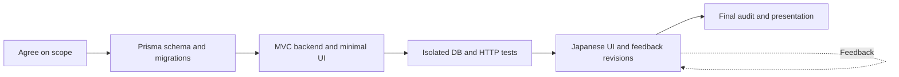

**Speaker notes**

Walk through the phases in order. We first settled the public scope, roles and meaning of kitchen management. With no initial tables, we defined a Prisma schema and versioned migrations. The backend used minimal pages so forms, permissions and transactions could be tested before investing in artwork. The next phase introduced the Japanese exterior, house, dining room, kitchen, pantry and office. Feedback changed the menu, recipe editing, guidance and motion. The final pass revisited the original technical requirements and corrected bugs rather than assuming that visual changes left every behavior intact. This workflow separates product decisions from implementation and verification without turning them into separate projects.

**Project evidence:** `README.md`, `docs/ui-revision.md`, `tests/`.

---

## Slide 09 — Backend decisions

Use JavaScript rather than TypeScript, as requested. Express and EJS implement SSR. Prisma 7 with PrismaPg connects to Supabase PostgreSQL. Models and versioned migrations define the database before deployment. Static restaurant copy stays in EJS instead of restaurant_settings or content_sections tables. Credentials are private and ignored by Git.

**Speaker notes**

The team explicitly chose JavaScript, Supabase, Prisma, code-first development, MVC and PRG. Express and EJS are supporting implementation choices that fit those requirements. Code-first does not mean tables appear merely by starting the server: models describe the desired schema, and reviewed migrations create it in PostgreSQL. The runtime database URL is for application queries, while the migration connection is used by migration tooling; actual values never belong in this presentation. Static restaurant content is edited in templates because this exercise does not need a CMS. Supabase is used as PostgreSQL hosting, while the Express server is the application access boundary. No Supabase API key is needed for this Prisma backend.

**Project evidence:** `README.md`, `package.json`, `prisma/schema.prisma`.

---

## Slide 10 — MVC and server rendering

Browser → routes/security → controller/validators → service → model/repository → Prisma/PostgreSQL. The controller passes data to EJS, which returns HTML. Optional browser enhancement requests another server-rendered page and replaces the relevant fragment. Standard links and forms remain available.

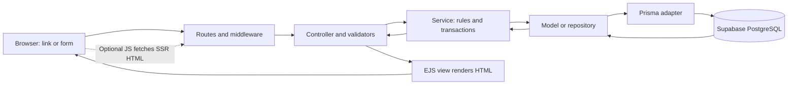

**Speaker notes**

Follow a menu request or recipe form through the diagram. Routes identify the resource; middleware restores the session and checks access or CSRF when needed. Controllers coordinate HTTP input, validation and responses. Services implement business rules and transactions. Models or repositories hold data access, with Prisma connecting to PostgreSQL. Service results return to the controller, which renders the EJS view and sends HTML. Menu turns and recipe sheets use JavaScript to fetch SSR HTML and animate a fragment. This preserves SSR because the browser does not become the authoritative renderer or the permission layer. With JavaScript disabled, ordinary links and form submissions still work.

**Project evidence:** `src/app.js`, `src/routes/index.js`, `src/controllers/`, `src/services/`, `src/models/`, `src/views/`.

---

## Slide 11 — Database relations

Nine application models: StaffUser, Category, Dish, Ingredient, Recipe, RecipeItem, StockOperation, StockMovement and Session. Category groups dishes; a dish has at most one recipe; recipes reference ingredients through RecipeItem. Staff record operations, each operation has movements for ingredients. Sessions store server-side session data independently. Full field types are in the appendix.

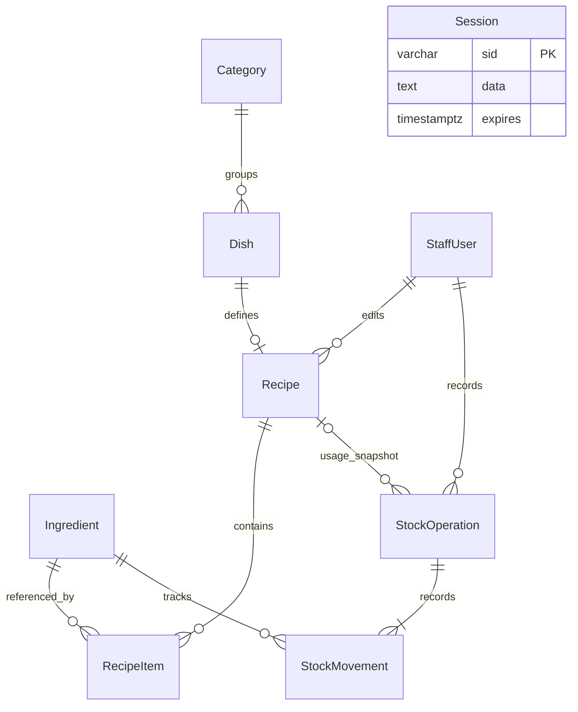

**Speaker notes**

Explain the model groups rather than reading every field. Categories and dishes form the public catalog. Each dish can have one recipe, and RecipeItem is a composite-key join table containing quantity per serving. Ingredient stores the current balance and low-stock threshold. StockOperation is the business event header; StockMovement stores before, delta and after for each ingredient. StaffUser links editors and stock actors to the audit trail. Session stores login session data and expiry; it has no staff foreign key because identity is inside the session payload. There are nine application tables plus Prisma migration metadata. Money is integer VND and stock quantities use exact decimals. Catalog DELETE actions archive records; removing a chef deactivates access while preserving history.

**Project evidence:** `prisma/schema.prisma`, `prisma/migrations/`.

---

## Slide 12 — HTTP, PRG and DELETE

HTML forms send POST with hidden _method=DELETE and the session CSRF token. Middleware accepts only this POST body override, then executes the DELETE resource handler with CSRF and role checks. Success returns 303 and Location; browser follows GET. GET links never archive or deactivate. Validation 422, conflicts 409, forbidden 403, missing 404.

```mermaid
sequenceDiagram
  participant B as Browser
  participant E as Express
  participant D as Prisma / DB
  B->>E: POST /kitchen/dishes/:id + CSRF + _method=DELETE
  Note over E: Override to DELETE; check CSRF and role
  E->>D: Archive dish in transaction
  D-->>E: Success
  E-->>B: 303 See Other + Location: /kitchen/dishes
  B->>E: GET /kitchen/dishes
  E-->>B: Server-rendered HTML
  Note over B: Refresh repeats GET, not the mutation
```

```html
<!-- Example only: EJS inserts the real session-bound CSRF value. -->
<form method="post" action="/kitchen/dishes/DISH_ID">
  <input type="hidden" name="_csrf" value="SESSION_CSRF">
  <input type="hidden" name="_method" value="DELETE">
  <button type="submit">Archive dish</button>
</form>
```

The browser sends POST; method override selects the Express DELETE route. The resource remains archived for history. Success redirects with HTTP 303.

**Speaker notes**

HTML forms support GET and POST, so the browser submits POST to the resource URL with a hidden method override. The server changes only a POST body value equal to DELETE into the DELETE request method; query parameters, headers and GET overrides are ignored. CSRF and role checks remain in force. After a successful archive, the response is 303 See Other with a collection Location, and the browser issues GET. Refresh repeats that GET instead of resubmitting the archive. The example token is a placeholder, not a real session value. PRG is for successful mutations: invalid input is shown with 422 and conflicts with 409 so the user can recover. Archive/deactivate behavior preserves historical data.

**Project evidence:** `src/app.js`, `src/routes/index.js`, `src/middleware/security.js`, `src/views/`, `tests/`.

---

## Slide 13 — Role permissions

See the role matrix below. Customers browse without an account. Chef and admin access is enforced in middleware and services, with active role/status reloaded on each request. Deactivating a chef takes effect on the next request.

| Action | Customer | Chef | Admin |
| --- | --- | --- | --- |
| Introduction, menu, dish details | Yes | Yes | Yes |
| Dishes | Published menu only | Create / edit / archive | Create / edit / archive |
| Recipes | — | View / edit | View / edit |
| Inventory and history | — | View | View |
| Record usage / waste | — | Yes | Yes |
| Receive stock / correct counts | — | — | Yes |
| Categories / ingredient metadata | — | — | Create / edit / archive |
| Chef accounts | — | — | Create / update / deactivate |

**Speaker notes**

Read the differences between chef and administrator. Both can maintain dishes and recipes and record usage or waste. A chef can inspect stock and its history but cannot create ingredient metadata, change categories, receive stock or correct counts. Those actions belong to administrators, who also manage chef accounts. The same restrictions apply to a direct HTTP request even if somebody bypasses the UI. Login rotates the session ID, logout destroys it, and credentials are stored as Argon2 hashes. The database-backed session cookie is HTTP-only, SameSite Lax and secure in production. CSRF is checked on mutations. A staff account is reloaded on every authenticated request so deactivation is effective without waiting for its session to expire.

**Project evidence:** `README.md`, `src/middleware/security.js`, `src/services/auth-service.js`, `src/routes/index.js`.

---

## Slide 14 — Recipe and stock workflow

A recipe defines quantity per serving. Usage multiplies it by servings; 100 g rice × 2 deducts 200 g, reducing 2,500 g to 2,300 g. Editing a recipe changes no stock. Usage/waste create immutable movement history. Receipt adds stock; correction adds a signed compensating entry. Insufficient stock rolls back all ingredients.

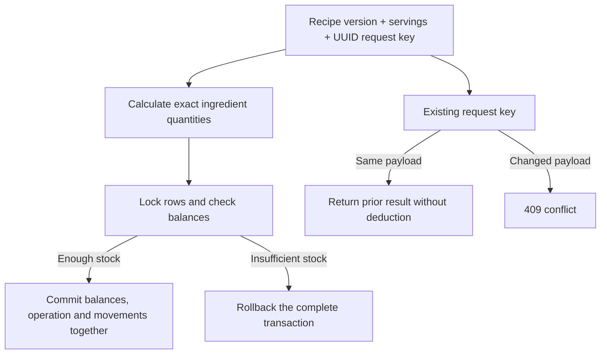

**Speaker notes**

Use the rice calculation to make the data model concrete. The recipe contains per-serving quantities, and preparing two servings records actual usage for every ingredient. The service snapshots the recipe version and uses Decimal arithmetic. Deterministic row locks and a Prisma transaction commit the balance changes, operation and movement rows together. Insufficient stock in even one ingredient rolls back the whole operation. A UUID request key prevents repeat submission from deducting twice; reusing it with different data is a conflict. Optimistic recipe versions prevent one editor silently overwriting another. The audit ledger is immutable: a correction adds a compensating event instead of rewriting the past. The application uses Prisma data access with tagged SQL for locking inside transactions.

**Project evidence:** `src/services/recipe-service.js`, `src/services/stock-service.js`, `prisma/migrations/`.

---

## Slide 15 — Final verification and fixes

The presentation-preparation test run passed 38 tests with zero failures. The earlier final audit also checked the Prisma schema and browser flows. Bugs fixed included archived-resource updates, signed corrections, form recovery, retained ingredient selections and pending form controls. Tests use isolated PGlite and Supertest, not live Supabase or production concurrency. Parent repository organization was corrected without recreating a nested repo.

**Speaker notes**

State what was verified and where the evidence ends. The 38 tests cover HTTP behavior, access restrictions, escaping, CSRF, method override, archive protection and stock or recipe rules. They use PGlite through PrismaPg plus Supertest and serialize embedded transactions; they do not demonstrate multi-connection behavior under production load. Browser QA used disposable sample records for paper saves and failure recovery. The audit corrected several small but important behaviors, including submitted edits to archived records and lost ingredient selections past the first 100 pantry rows. Another lesson was repository organization: a nested checkout obscured the existing parent repository. Its metadata was backed up and the exercise now belongs to the parent history. No live credentials or Supabase data were needed for presentation work.

**Project evidence:** `README.md`, `tests/`, `docs/ui-revision.md`.

---

## Slide 16 — Live demonstration

Demo sequence: entrance → house → public menu filters/turn/details → prepared chef login → recipe edit → record usage → ledger → administrator tools → archive a disposable dish and inspect POST override/DELETE handler/303/GET. Use a prepared demo environment. Saved screenshots provide an offline fallback. No migration or seed is required just to open this presentation.

**Speaker notes**

Keep the demo short and rehearse it with known sample records before presenting. Start the already configured app with npm start from restaurant-mvc; do not run migrations or reseed merely to give the talk. Use a prepared chef account without showing its password, then demonstrate a harmless recipe change and a small usage operation on demo stock. Switch to an administrator to explain the additional permissions. If showing DELETE, choose a clearly disposable demo dish and inspect the request in browser developer tools: the browser sends POST, the override invokes DELETE, and a 303 leads to GET. Do not delete real records for the presentation. If connectivity or login fails, use the screenshot appendix and describe the documented behavior. Finish by inviting questions about SSR, roles and stock integrity.

**Project evidence:** `README.md`, `src/routes/index.js`, `tests/`.

---

## Appendix A — Team decision log

This log follows the conversation’s progression. “Team decision” refers to a direct requirement or an accepted revision. Supporting implementation choices are documented separately rather than attributed to the team as explicit requests.

| ID | Subject | Team decision | Result / reason |
| --- | --- | --- | --- |
| D01 | Restaurant introduction | Public landing page and menu; exclude ordering, reservations and customer accounts. | Keeps the exercise focused on information and staff management. |
| D02 | JavaScript | Use JS after the team questioned TypeScript. | Matches the exercise and avoids a separate type compilation step. |
| D03 | Supabase | Use managed PostgreSQL in Supabase. | Database hosting with a relational backend. |
| D04 | Code-first database | Start without tables; define models and migrations in code. | Schema becomes versioned, reviewable project material. |
| D05 | Prisma ORM | Use the recommended Node.js ORM connected to Supabase. | Prisma models and queries satisfy the ORM requirement. |
| D06 | MVC | Separate models, views and controllers in a dedicated exercise directory. | HTTP, data access and rendering have explicit responsibilities. |
| D07 | HTTP | Use HTTP methods and status codes deliberately. | GET reads; POST mutates; DELETE archives/deactivates resources. |
| D08 | PRG | Redirect successful form submissions with HTTP 303. | Refreshing the resulting page repeats GET. |
| D09 | Static restaurant copy | Keep introduction/settings/content sections in templates. | No CMS tables for fixed content. |
| D10 | Three roles | Public customers, authenticated chefs and admins. | Customer is a visitor role, not an account table. |
| D11 | Kitchen meaning | Maintain recipes and manually record ingredient usage or waste. | Kitchen board represents dishes, not live customer orders. |
| D12 | Credential privacy | Keep .env ignored and never inspect it after creation. | The owner supplies credentials privately. |
| D13 | Backend first | Implement backend with minimal test UI before the visual phase. | Verify persistence, roles and forms before animation work. |
| D14 | Japanese setting | Exterior sliding door; house with dining left, kitchen right, office ahead. | The rooms become navigation destinations. |
| D15 | Dining revision | Replace dish trays with a menu book on a dining-table background. | Four dishes per spread, search/sort/category filters and click details. |
| D16 | Kitchen revision | Use a Japanese kitchen image, ticket board and paper-like recipe editor. | Editing lifts a sheet; confirmed save returns it. |
| D17 | Ingredient experience | Accept pantry jars/list, low-stock search, ledgers and stock actions. | Ingredient data has a visual shelf and an auditable record. |
| D18 | House guidance revision | Replace boxes and then rejected small signs with glowing floor arrows. | Guidance belongs to the scene; labels work on focus and phones. |
| D19 | Motion revision | Use doors only on first entrance; POV room changes; normal same-room links. | Removes repeated door overlays and buggy guide text. |
| D20 | Menu turn timing | Slow the page flip and give it two faces, moving light and reverse direction. | Current turn lasts 800 ms instead of the earlier fast turn. |
| D21 | Kitchen preservation | Keep the accepted kitchen design during the final motion/house changes. | Later refinements stay within the requested scope. |
| D22 | Group identity | Rename Komorebi to 三太子亭 — Santaishi-tei for Tam Thái Tử. | Brand appears across titles, menus, tickets, pantry and footer. |
| D23 | Final backend audit | Recheck SSR, MVC, Prisma, PRG, permissions and DELETE override; fix bugs. | Final audit covers archived edits, recovery and method safety. |
| D24 | Repository organization | Keep the exercise inside the existing Webapp Developing Git checkout. | Nested Git metadata was backed up; the exercise uses parent history. |
| D25 | Presentation materials | Create HTML and Markdown with diagrams, screenshots, decisions and notes. | Offline presentation plus detailed rehearsal/reference document. |
| D26 | Presentation order | Review the completed website before discussing the backend and other technical details. | Entrance, dining, kitchen, pantry/office and design feedback follow the cover; backend slides follow them. |

### Supporting implementation choices

| Choice | Implementation rationale |
| --- | --- |
| Express 5 + EJS | JavaScript HTTP server and server-rendered views fit the requested SSR/MVC approach. |
| Private restaurant schema | Server owns database access; Supabase anon/authenticated roles cannot access these tables. |
| Nine application models | Catalog, staff, recipes, stock history and sessions; no customer/order/booking models. |
| BIGINT and NUMERIC(14,3) | Integer VND prices and Decimal quantities avoid floating-point balance errors. |
| Transactions and locks | Balances, operation headers and movement rows commit together; tagged SQL supplies row/advisory locks. |
| Version + request key | Recipe versions detect stale edits; stock request keys prevent duplicate deductions. |
| Archive and deactivation | Catalog archives and inactive staff preserve historical foreign keys. |
| Session security | Argon2 password hashes, DB-backed sessions, rotated login IDs, CSRF and per-request role reload. |
| SSR enhancement | Browser JS requests server-rendered HTML fragments for paper/menu effects; standard links/forms remain. |
| Local artwork | Generated backgrounds and dish art, optimized JPGs; PNG masters/prompts retained. |
| Isolated verification | PGlite through PrismaPg and Supertest, plus browser checks using fictional sample records. |
| Current boundaries | Local image paths, capped staff lists, no uploads, reset email, suppliers, expiry batches or multiple locations. |

## Appendix B — Full database field reference

All scalar fields from `prisma/schema.prisma` are included below. Table names are in the private `restaurant` schema. Relation objects and arrays are virtual Prisma fields, not SQL columns. A `?` marks nullable Prisma fields. `uuid()` is a Prisma client-generated default; `@updatedAt` is maintained by Prisma. Foreign keys use restricted deletion. The model list excludes `_prisma_migrations`, which is migration tooling metadata.

### StaffUser — `restaurant.staff_users`

| Prisma field | SQL column | Prisma type | SQL type | Nullable | Defaults / keys |
| --- | --- | --- | --- | --- | --- |
| id | id | String | UUID | No | PK; default uuid() |
| email | email | String | VARCHAR(254) | No | UNIQUE |
| passwordHash | password_hash | String | TEXT | No | — |
| displayName | display_name | String | VARCHAR(100) | No | — |
| role | role | String | VARCHAR(10) | No | — |
| isActive | is_active | Boolean | BOOLEAN | No | default true |
| lastLoginAt | last_login_at | DateTime? | TIMESTAMPTZ | Yes | — |
| createdAt | created_at | DateTime | TIMESTAMPTZ | No | default now() |
| updatedAt | updated_at | DateTime | TIMESTAMPTZ | No | default now(); Prisma updates timestamp |

Primary and unique keys are shown above.

### Category — `restaurant.categories`

| Prisma field | SQL column | Prisma type | SQL type | Nullable | Defaults / keys |
| --- | --- | --- | --- | --- | --- |
| id | id | String | UUID | No | PK; default uuid() |
| name | name | String | VARCHAR(100) | No | — |
| slug | slug | String | VARCHAR(120) | No | UNIQUE |
| description | description | String? | TEXT | Yes | — |
| displayOrder | display_order | Int | INTEGER | No | default 0 |
| isActive | is_active | Boolean | BOOLEAN | No | default true |
| archivedAt | archived_at | DateTime? | TIMESTAMPTZ | Yes | — |
| createdAt | created_at | DateTime | TIMESTAMPTZ | No | default now() |
| updatedAt | updated_at | DateTime | TIMESTAMPTZ | No | default now(); Prisma updates timestamp |

Primary and unique keys are shown above.

### Dish — `restaurant.dishes`

| Prisma field | SQL column | Prisma type | SQL type | Nullable | Defaults / keys |
| --- | --- | --- | --- | --- | --- |
| id | id | String | UUID | No | PK; default uuid() |
| categoryId | category_id | String | UUID | No | FK |
| name | name | String | VARCHAR(150) | No | — |
| slug | slug | String | VARCHAR(180) | No | UNIQUE |
| description | description | String? | TEXT | Yes | — |
| priceMinor | price_minor | BigInt | BIGINT | No | — |
| currency | currency | String | VARCHAR(3) | No | default "VND" |
| imagePath | image_path | String? | TEXT | Yes | — |
| imageAlt | image_alt | String? | VARCHAR(200) | Yes | — |
| isFeatured | is_featured | Boolean | BOOLEAN | No | default false |
| isPublished | is_published | Boolean | BOOLEAN | No | default false |
| isAvailable | is_available | Boolean | BOOLEAN | No | default true |
| displayOrder | display_order | Int | INTEGER | No | default 0 |
| archivedAt | archived_at | DateTime? | TIMESTAMPTZ | Yes | — |
| createdAt | created_at | DateTime | TIMESTAMPTZ | No | default now() |
| updatedAt | updated_at | DateTime | TIMESTAMPTZ | No | default now(); Prisma updates timestamp |

Additional constraints: `@@index([categoryId, isPublished])`.

### Ingredient — `restaurant.ingredients`

| Prisma field | SQL column | Prisma type | SQL type | Nullable | Defaults / keys |
| --- | --- | --- | --- | --- | --- |
| id | id | String | UUID | No | PK; default uuid() |
| name | name | String | VARCHAR(150) | No | UNIQUE |
| description | description | String? | TEXT | Yes | — |
| baseUnit | base_unit | String | VARCHAR(10) | No | — |
| quantityOnHand | quantity_on_hand | Decimal | NUMERIC(14,3) | No | default 0 |
| lowStockThreshold | low_stock_threshold | Decimal | NUMERIC(14,3) | No | default 0 |
| isActive | is_active | Boolean | BOOLEAN | No | default true |
| archivedAt | archived_at | DateTime? | TIMESTAMPTZ | Yes | — |
| createdAt | created_at | DateTime | TIMESTAMPTZ | No | default now() |
| updatedAt | updated_at | DateTime | TIMESTAMPTZ | No | default now(); Prisma updates timestamp |

Primary and unique keys are shown above.

### Recipe — `restaurant.recipes`

| Prisma field | SQL column | Prisma type | SQL type | Nullable | Defaults / keys |
| --- | --- | --- | --- | --- | --- |
| id | id | String | UUID | No | PK; default uuid() |
| dishId | dish_id | String | UUID | No | UNIQUE; FK |
| instructions | instructions | String | TEXT | No | default "" |
| preparationMinutes | preparation_minutes | Int? | INTEGER | Yes | — |
| cookingMinutes | cooking_minutes | Int? | INTEGER | Yes | — |
| version | version | Int | INTEGER | No | default 1 |
| updatedBy | updated_by | String | UUID | No | FK |
| createdAt | created_at | DateTime | TIMESTAMPTZ | No | default now() |
| updatedAt | updated_at | DateTime | TIMESTAMPTZ | No | default now(); Prisma updates timestamp |

Primary and unique keys are shown above.

### RecipeItem — `restaurant.recipe_items`

| Prisma field | SQL column | Prisma type | SQL type | Nullable | Defaults / keys |
| --- | --- | --- | --- | --- | --- |
| recipeId | recipe_id | String | UUID | No | FK |
| ingredientId | ingredient_id | String | UUID | No | FK |
| quantity | quantity | Decimal | NUMERIC(14,3) | No | — |
| notes | notes | String? | VARCHAR(250) | Yes | — |
| createdAt | created_at | DateTime | TIMESTAMPTZ | No | default now() |
| updatedAt | updated_at | DateTime | TIMESTAMPTZ | No | default now(); Prisma updates timestamp |

Additional constraints: `@@id([recipeId, ingredientId]) @@index([ingredientId])`.

### StockOperation — `restaurant.stock_operations`

| Prisma field | SQL column | Prisma type | SQL type | Nullable | Defaults / keys |
| --- | --- | --- | --- | --- | --- |
| id | id | String | UUID | No | PK; default uuid() |
| type | type | String | VARCHAR(12) | No | — |
| reason | reason | String | TEXT | No | — |
| recipeId | recipe_id | String? | UUID | Yes | FK |
| recipeVersion | recipe_version | Int? | INTEGER | Yes | — |
| servings | servings | Int? | INTEGER | Yes | — |
| createdBy | created_by | String | UUID | No | FK |
| requestKey | request_key | String | UUID | No | UNIQUE |
| createdAt | created_at | DateTime | TIMESTAMPTZ | No | default now() |

Additional constraints: `@@index([createdAt])`.

### StockMovement — `restaurant.stock_movements`

| Prisma field | SQL column | Prisma type | SQL type | Nullable | Defaults / keys |
| --- | --- | --- | --- | --- | --- |
| id | id | String | UUID | No | PK; default uuid() |
| operationId | operation_id | String | UUID | No | FK |
| ingredientId | ingredient_id | String | UUID | No | FK |
| quantityDelta | quantity_delta | Decimal | NUMERIC(14,3) | No | — |
| quantityBefore | quantity_before | Decimal | NUMERIC(14,3) | No | — |
| quantityAfter | quantity_after | Decimal | NUMERIC(14,3) | No | — |
| createdAt | created_at | DateTime | TIMESTAMPTZ | No | default now() |

Additional constraints: `@@unique([operationId, ingredientId]) @@index([ingredientId, createdAt])`.

### Session — `restaurant.sessions`

| Prisma field | SQL column | Prisma type | SQL type | Nullable | Defaults / keys |
| --- | --- | --- | --- | --- | --- |
| sid | sid | String | VARCHAR(36) | No | PK |
| data | data | String | TEXT | No | — |
| expires | expires | DateTime | TIMESTAMPTZ | No | — |
| createdAt | created_at | DateTime | TIMESTAMPTZ | No | default now() |
| updatedAt | updated_at | DateTime | TIMESTAMPTZ | No | default now(); Prisma updates timestamp |

Additional constraints: `@@index([expires])`.

### Additional database integrity

- `recipe_items` has a composite primary key: `(recipe_id, ingredient_id)`.
- CHECK constraints enforce valid roles and units, nonnegative ingredient balances, positive recipe quantities, complete recipe-usage references, and valid movement signs/math.
- Triggers preserve immutable stock history and prevent changing a referenced ingredient’s unit.
- Archived catalog records and inactive staff retain history and foreign-key references.
- Money is integer VND in `BIGINT`. Quantities use exact `NUMERIC(14,3)` and Decimal calculations.
- Recipe versions reject stale edits. Operation request keys prevent repeat deductions and reject reuse with a changed payload.
- Prisma transactions commit ingredient balances, operation headers and movement history together. Tagged SQL inside those transactions supplies deterministic row/advisory locks.
- The server-only schema denies access to Supabase `anon` and `authenticated` roles. Express authorization and restricted database credentials are the access boundary; Supabase client RLS is not the application’s authorization mechanism.

## Appendix C — HTTP endpoint reference

| Method | Path | Access | Behavior |
| --- | --- | --- | --- |
| GET | / ; /directory ; /menu ; /menu/:slug | Public | Introduction, room directory, filtered menu, dish details |
| GET / POST | /login | Public | Login form / authenticate (rate limited) |
| POST | /logout | Chef / admin | Destroy session → 303 |
| GET | /admin | Admin | Office overview |
| GET / POST | /admin/staff | Admin | List / create chef |
| POST | /admin/staff/:id/update | Admin | Update chef profile / access |
| DELETE | /admin/staff/:id | Admin | Deactivate chef → 303 |
| GET | /admin/dishes | Admin | Legacy link → 303 /kitchen/dishes |
| GET | /kitchen | Chef / admin | Kitchen board |
| GET / POST | /kitchen/dishes/:id/recipe | Chef / admin | Recipe form / save versioned recipe |
| POST | /kitchen/dishes/:id/usage | Chef / admin | Deduct recipe quantities × servings |
| GET | /kitchen/ingredients/:id | Chef / admin | Balance, recipe references, latest 30 movements |
| GET | /kitchen/stock-history | Chef / admin | Latest 100 stock operations |
| GET | /kitchen/stock/new | Chef / admin | Role-aware stock operation form |
| POST | /kitchen/stock/receipts ; /kitchen/stock/corrections | Admin | Receive stock / signed compensating correction |
| POST | /kitchen/stock/usage ; /kitchen/stock/waste | Chef / admin | Manual ingredient deductions |
| GET / POST | /setup | Development + loopback; before first admin | Initial admin bootstrap; unavailable after setup |

### Catalog pattern

`BASE` is `/admin/categories`, `/kitchen/dishes`, or `/kitchen/ingredients`. Write access is administrator-only for categories and ingredient metadata, and chef/administrator for dishes.

| Method | Path | Access | Behavior |
| --- | --- | --- | --- |
| GET | BASE | Admin for categories; chef/admin for dishes and ingredient lists | Read collection |
| GET | BASE/new ; BASE/:id/edit | Write access | Render form |
| POST | BASE ; BASE/:id/update | Write access | Create / update → 303 |
| DELETE | BASE/:id | Write access | Archive → 303 |

### HTTP responses and mutation rules

- Successful form mutation: **303 See Other** with `Location`, followed by browser GET.
- Validation failure: **422** with input retained.
- Stale recipe or changed payload using an existing request key: **409**.
- Forbidden operation: **403**; missing resource: **404**.
- Unauthenticated mutation: **401**; protected page GET redirects to login.
- DELETE resource forms submit POST with hidden `_method=DELETE`; only this POST body override is accepted. GET, query-string and header overrides cannot trigger deletion.
- All mutations require session-bound CSRF. Archive/deactivation preserves history.
- Setup is a development-only, loopback-only bootstrap and closes once the first administrator exists. No staff credentials are seeded.

## Appendix D — Screenshot gallery and provenance

The main slides show entrance, house, menu, kitchen, recipe, pantry and office. The following screenshots support detailed questions:

### Dish detail popup


### Ingredient ledger after sample usage

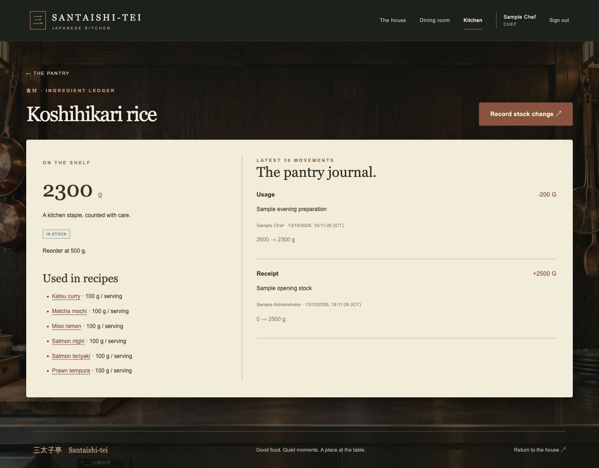

### Immutable stock-operation journal

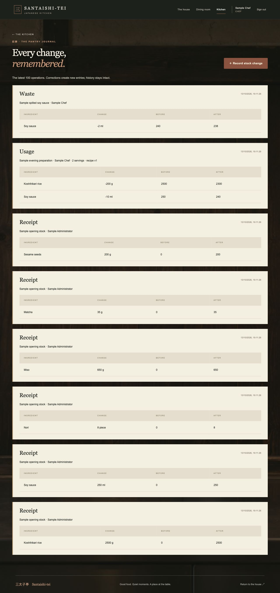


Entrance and house screenshots reuse the final branded UI previews. Other screenshots were captured from the implemented server-rendered UI using an isolated disposable database. `Sample Administrator`, `Sample Chef` and `.test` email addresses are fictional. Stock receipts, usage and waste in the screenshots are sample events. No live Supabase data or real staff credentials were used.

Generated background and dish artwork is documented in `public/images/japan/ASSETS.md`. Local JPG backgrounds total about 1.75 MB, compared with about 9.09 MB for the PNG masters, a reduction of approximately 80.7%; masters and prompts are retained. UI screenshots prove the static appearance; page turns and room motion should be demonstrated live.

The HTML embeds its images and has no CDN, external font or network dependency. Keep `presentation-assets/` alongside this Markdown document when moving it. Project source links below work from `presentation/` in the repository.

## Appendix E — Demo checklist

Before the presentation:

1. Open the HTML locally and test slide selection, arrow keys, notes, enlarged screenshots and fullscreen.
2. Start the already configured app from `restaurant-mvc` with `npm start`. Do not run migrations or reseed solely for the presentation.
3. Prepare a demo chef and administrator account. Keep passwords and `.env` off screen.
4. Use disposable demo dishes and enough demo inventory. Rehearse small, reversible edits; do not archive real records just for the talk.
5. Have browser developer tools ready to inspect method/status behavior.
6. Keep screenshots available if network, authentication or app startup fails.

| Step | Action | What to explain |
| --- | --- | --- |
| 1 | Enter exterior → house | Door at entrance; arrows indicate rooms |
| 2 | Open public menu, filter, sort, turn, select dish | SSR content plus browser enhancement |
| 3 | Sign in as prepared chef, edit recipe | Per-serving quantities; optimistic version; save returns sheet |
| 4 | Record two servings of usage on demo stock | Exact deduction, transaction, request key |
| 5 | Open ingredient ledger and journal | Immutable audit history and current balance |
| 6 | Show admin stock and chef controls | Role differences enforced on the server |
| 7 | Archive a disposable dish, inspect network | Browser POST → DELETE handler → 303 → GET |

Offline fallback: show the relevant saved screenshot, describe the verified workflow and avoid pretending a still image demonstrates motion or network behavior.

## Appendix F — Questions and answers

| Question | Answer |
| --- | --- |
| Does animation break SSR? | No. EJS creates the page and forms on the server. Browser enhancement fetches SSR HTML and animates it; ordinary navigation remains available. |
| Why no customer table? | Customer is an anonymous visitor role. Ordering, booking and customer sign-up were excluded. |
| Why static content outside the DB? | The introduction is fixed content, with no requested CMS editing workflow. EJS templates are sufficient. |
| Does saving a recipe deduct stock? | No. A recipe describes quantities per serving. Recording preparation usage or waste changes balances. |
| Is DELETE really used? | HTML POST plus body _method=DELETE invokes an Express DELETE resource route. GET/query/header overrides are rejected or ignored. |
| Why archive instead of physical delete? | Catalog history and foreign keys must remain valid. Chef removal sets inactive; stock history remains immutable. |
| Does PRG prevent every duplicate operation? | It avoids resubmission on refresh after success. Stock UUID request keys additionally prevent duplicate deductions. |
| Are the 38 tests production concurrency proof? | No. Embedded PGlite uses serialized transactions. Production uses row/advisory locks; cross-connection load tests are separate work. |
| Are the photos a real restaurant? | No. The background and food artwork are generated assets. Screenshots are the implemented UI with disposable sample records. |
| Where are the tables in Supabase? | Application tables are in the private restaurant schema, after migration deployment. Select that schema in the dashboard. |

## Appendix G — Verification evidence and current limits

During presentation preparation, `npm test` completed with **38 passed, 0 failed**. These tests use isolated PGlite through the Prisma PostgreSQL adapter and Supertest. The fixture serializes transactions on one embedded connection, so it is not a production load or cross-connection concurrency test. No `.env` is loaded and Supabase is not modified by those tests.

The earlier final audit also validated the Prisma schema with a temporary audit configuration and exercised paper saves, failed usage recovery, signed corrections, duplicate chef form recovery and DELETE confirmation with a disposable browser fixture. Fixes included blocked archived-resource updates, retained invalid form values, saved ingredients beyond the first 100 pantry results, Add/Remove state and locked fields during pending paper saves.

Most staff lists currently cap at 100 records. The ingredient ledger shows the latest 30 movements and the stock journal the latest 100 operations; public menu pagination covers published dishes. Uploaded media, password-reset email, supplier management, expiry batches, multiple locations and production load testing remain outside the exercise.

The Git issue was organizational: an embedded checkout in the exercise folder interfered with the intended parent-repository setup. Its metadata was backed up; `restaurant-mvc` now lives as an ordinary folder in the existing Webapp Developing repository. The presentation work does not create another repository or commit.

## Appendix H — Local project sources

- [Project overview](../README.md)
- [Project rules](../AGENTS.md)
- [Schema](../prisma/schema.prisma)
- [Versioned migrations](../prisma/migrations/)
- [HTTP routes](../src/routes/index.js)
- [Application / SSR setup](../src/app.js)
- [Security middleware](../src/middleware/security.js)
- [Model / repository layer](../src/models/)
- [Controllers](../src/controllers/)
- [Services](../src/services/)
- [Prisma configuration and adapter](../src/config/)
- [EJS views](../src/views/)
- [UI revisions](../docs/ui-revision.md)
- [Artwork provenance and prompts](../public/images/japan/ASSETS.md)
- [Automated checks and fixtures](../tests/)
- [Browser enhancements](../public/js/)
